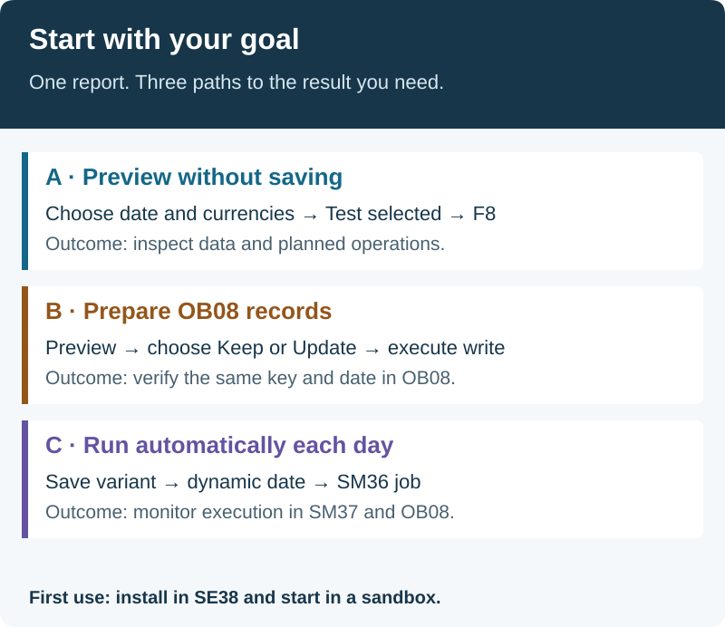

# Inspect, check and save TCMB rates in SAP

> **English** | [Türkçe](README.tr.md)

Use one report to read daily rates from the Central Bank of the Republic of Türkiye (TCMB). **Preview without saving, then add missing exchange rates or update different existing values.** Verify saved records in OB08.

## What do you want to do?

| Goal | Start here |
|---|---|
| Install for the first time | [One-file SE38 installation](WALKTHROUGH.md#install) |
| See the data first | [Path A: preview without saving](WALKTHROUGH.md#preview) |
| Add missing OB08 rates | [Path B: Keep existing and insert missing](WALKTHROUGH.md#first-write) |
| Replace existing rates with TCMB values | [Path B: Update and verify OB08](WALKTHROUGH.md#first-write) |
| Run automatically every day | [Path C: variant and scheduled job](WALKTHROUGH.md#daily-use) |
| Understand a field | [Field reference](TECHNICAL.md#selection-fields) |
| Recover from lock errors | [Partial writes and recovery](WALKTHROUGH.md#locks-and-partial-writes) |

## You need three things

1. **SAP access:** an ABAP developer able to create and activate a report in SE38. Upload the [single source file](src/zche_tcmb_load.prog.abap) as `ZCHE_TCMB_LOAD`. No separate installer or mandatory abapGit setup.
2. **Rate choices:** which currencies, SAP rate types and valid-from dates? Verify the FI setup and translation ratios in your system.
3. **Connectivity:** HTTPS from the SAP application server to `www.tcmb.gov.tr:443` and certificate trust. No extra server software, TCMB account or password. Browser access on your laptop alone is insufficient.

**Dil / Language → Türkçe** also works in an English SAP session; choose English for English report text. SAP standard screens retain their own language.

A **variant** stores reusable selections. **OB08** is SAP's rate-maintenance screen: the report writes, you verify there. Perform first trials in DEV/a sandbox.

## Scope and validation status

- The quote currency is **TRY**; the report does not calculate cross rates or create accounting documents.
- Test mode is selected by default. `NEW` / `UPDATED` in a preview describe planned operations.
- Fresh installation needs no custom tables, domains, data elements, global classes or separate installer. abapGit is optional.
- **v0.3.0 integration candidate.** The syntax target is ABAP 7.00. Runtime on actual 7.00/7.01/7.02 systems remains unverified.
- **Observed on A4H:** TCMB connectivity, Turkish results, some rates visible in OB08, and a completed one-off preview job using a Turkish variant. [Illustrated job setup](WALKTHROUGH.md#daily-use).
- **Still being verified:** all 48 current SAP Unit tests, older SAP releases, dynamic daily dates and actual-write jobs. Four previously lock-failed keys remain missing; the latest preview did not write them. [Validation record](docs/validation-v0.3.0.md).

The language choice covers selection labels, the date-rule list, project-authored messages and result-list headings. Technical status codes such as `NEW` / `ERROR` stay unchanged, with a description in the selected language. SAP GUI menus and raw SAP/BAPI/OS diagnostics may remain in their system/logon language.

If SAP has no internet access, use [XML files staged in a server folder](WALKTHROUGH.md#read-from-files). Downloading/staging them is outside this project.

If the older multi-object edition is installed, read [the migration note](TECHNICAL.md#migration-from-the-old-edition). Old SAP objects are not automatically deleted; this report does not use the old profile tables.

## Guides

| Your task | Document |
|---|---|
| Install, run, save a variant or schedule daily use | [Step-by-step guide](WALKTHROUGH.md) |
| Fields, local classes, extensions and errors | [Technical reference](TECHNICAL.md) |
| Checks and SAP acceptance | [CONTRIBUTING.md](CONTRIBUTING.md) |
| Changes | [CHANGELOG.md](CHANGELOG.md) |

MIT licensed. [License](LICENSE) · [Report an issue](https://github.com/Cheditte/abap-tcmb-rates/issues)
