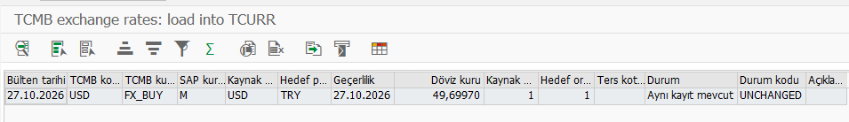

# TCMB exchange rates → SAP

> **English** | [Türkçe](README.tr.md)

`ZCHE_TCMB_LOAD` is a single ABAP report that loads daily exchange rates from the Central Bank of the Republic of Türkiye (TCMB) into SAP **OB08 / TCURR**, using `BAPI_EXCHANGERATE_CREATE`. Copy one file into SE38, preview the rates, then save them.

## What do you want to do?

| Goal | Guide |
|---|---|
| Install the report | [One-file SE38 setup](WALKTHROUGH.md#install) |
| Test without saving | [Preview rates](WALKTHROUGH.md#preview) |
| Add or update OB08 rates | [Write and verify](WALKTHROUGH.md#first-write) |
| Run automatically each day | [Dynamic-date variant and job](WALKTHROUGH.md#daily-use) |
| Understand the fields or extend the report | [Technical reference](TECHNICAL.md) · [Screen guide, Turkish only](SCREENS.tr.md) |

## Three things to prepare

1. **SAP access:** create and activate `ZCHE_TCMB_LOAD` in SE38 using the [source file](src/zche_tcmb_load.prog.abap). A separate installer, custom tables and abapGit are unnecessary; abapGit remains an alternative.
2. **Rate choices:** decide currencies, SAP rate types and valid-from dates. Check translation ratios in OBBS, especially for currencies quoted per 100 units.
3. **Connection:** the SAP application server must reach `www.tcmb.gov.tr:443` over HTTPS and trust its certificate. No TCMB account, password or extra server software is required.

Choose **Türkçe** or **English** on the report. Save reusable settings as a standard SAP variant. Test mode is selected initially; first try one day and one currency in DEV/test.

## Compatibility and verification

| Environment / check | Status |
|---|---|
| SAP ABAP Platform 2023 / SAP_BASIS 7.58 | Current report: warning-free activation, 55/55 SAP Unit tests, HTTPS preview and dynamic-date preview job passed. |
| Current publication candidate | v700 lint/source checks pass; invalid direct URL and parent-folder selections rejected. Earlier revision: limited writes verified in OB08. |
| ECC 6.0 / SAP_BASIS 7.00–7.02 | 7.00 syntax target; runtime not yet tested. Feedback welcome. |

[Full verification table and known limits](docs/validation.md). [Upgrading an older installation](TECHNICAL.md#migration-from-the-old-edition).

## Frequently asked questions

### How do I load TCMB exchange rates into SAP automatically?
Install the report, verify a preview and a controlled write, then schedule a daily SM36 job using a variant with **dynamic current date**. Follow [the job guide](WALKTHROUGH.md#daily-use).

### Does it work on ECC 6.0?
The code targets ABAP 7.00 syntax. Actual ECC 6.0 runtime acceptance is still pending; see the table above.

### What happens on public holidays?
Saturdays and Sundays are skipped. HTTP 404 on a requested weekday becomes `NO_BULLETIN`; select information, warning or job error behavior. Another day's rate is not substituted automatically.

### Why is JPY per 100 units?
TCMB's XML `Unit` states the quoted quantity. The report combines it with SAP's TCURF/OBBS factors; do not assume every currency uses 1:1. [Calculation](TECHNICAL.md#dates-and-ratios).

### Which authorizations are needed?
Writing requires table-maintenance change authorization for `V_TCURR` (typically `S_TABU_DIS`, group `FB32`; verify your system). Server files need `S_DATASET` read authorization. Job scheduling/execution needs the appropriate background permissions. [Who needs what](WALKTHROUGH.md#authorizations).

MIT licensed · [License](LICENSE) · [Changes](CHANGELOG.md) · [Contributing](CONTRIBUTING.md) · [Issues](https://github.com/Cheditte/abap-tcmb-rates/issues)
