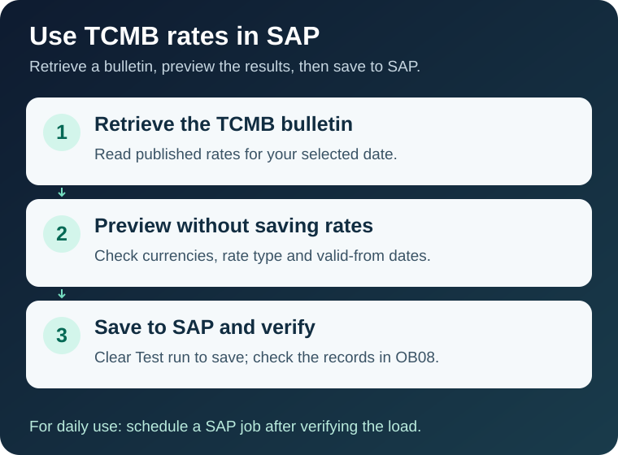

# Load TCMB exchange rates into SAP

> **English** | [Türkçe](README.tr.md)

Use this project to load the daily exchange rates published by the Central Bank of the Republic of Türkiye (TCMB) into SAP. You choose the currencies, buying or selling rates, and the date from which each rate is valid.

Preview the results **without saving exchange rates**, review them, then run the actual load. Once verified, you can schedule it as a daily SAP background job.

## Start here

**[Open the step-by-step installation and usage guide →](WALKTHROUGH.md)**

The guide assumes you are an ABAP developer who can run reports in SE38 and manage development objects. It explains where FI decisions and connectivity permissions are needed. Complete those tasks yourself if you have the relevant access, or involve the team that manages them.

## Think of setup in three steps

| Step | What you do | What is ready afterwards |
|---|---|---|
| **1. Install in SAP** | Import the project into your development package with abapGit. Generate the settings-maintenance screens. | The report and configuration tables. |
| **2. Choose your rules** | Save currencies, rate mappings and validity rules in a profile. Check that SAP can reach TCMB. | Settings that define which rates to load and how. |
| **3. Try it, then use it** | Preview one day and a few currencies. Verify the output, perform a real load, then schedule a job if needed. | SAP exchange rates you can check in OB08. |

A **profile** is a saved group of settings that you reuse for each run. The report is **`ZCHE_TCMB_LOAD`**; run it through SE38. **OB08** is the SAP transaction for displaying and maintaining exchange rates.

## What you need

- A development or sandbox SAP system, installation permissions and [abapGit](https://docs.abapgit.org/user-guide/getting-started/install.html).
- SAP currencies, rate types and translation ratios. Confirm these choices against your FI/accounting process.
- HTTPS access from the **SAP application server** to **`www.tcmb.gov.tr:443`**. Opening the site on your laptop does not establish connectivity from SAP.

**The standard HTTPS route does not require an extra helper application on the SAP server.** Network and certificate configuration may be necessary. For SAP systems without outbound access, an [alternative route](WALKTHROUGH.md#read-from-files) reads XML files staged in a server folder; preparing those files is outside this project.

## Scope and current status

- The quote currency is **TRY**. The project does not calculate cross rates between other currencies.
- It loads standard SAP exchange-rate records through a BAPI; it does not create accounting documents.
- Test mode is selected by default. In a test run, `NEW` / `UPDATED` describe what a real load would do.
- **Pre-release: v0.1.** Current code awaits SAP runtime validation. Static checks for 7.40 SP08 and 7.58 do not establish runtime compatibility. Historical ABAP Platform 2023 evidence is explained in the [technical reference](TECHNICAL.md#validation-and-contributing).

## Choose a guide

| Your task | Document |
|---|---|
| Install, create a first profile and run the report | [Installation and usage](WALKTHROUGH.md) |
| Look up settings, call classes from your own code, extend the project or understand errors | [Technical reference](TECHNICAL.md) |
| Run checks or contribute | [CONTRIBUTING.md](CONTRIBUTING.md) |
| Review changes | [CHANGELOG.md](CHANGELOG.md) |

MIT licensed. [License](LICENSE) · [Report an issue / suggest an improvement](https://github.com/Cheditte/abap-tcmb-rates/issues)
