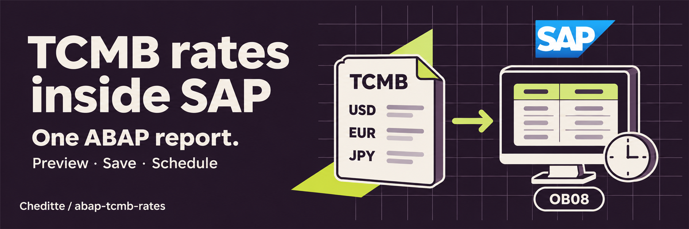

# TCMB döviz kurları → SAP

> [English](README.md) | **Türkçe**

**Tek programı yükleyin, çalıştırın; TCMB kurlarını SAP’ye alın.**

`ZCHE_TCMB_LOAD` ile TCMB'nin günlük döviz kurlarını SAP'de görüntüleyebilir, kaydetmeden inceleyebilir ve ardından SAP'ye aktarabilirsiniz. Aynı işlemi her gün otomatik çalışacak şekilde de planlayabilirsiniz.

SAP Community yazısı (İngilizce): [Import TCMB Exchange Rates into SAP with a Single ABAP Report](https://community.sap.com/t5/technology-blog-posts-by-members/import-tcmb-exchange-rates-into-sap-with-a-single-abap-report/ba-p/14515126)

## Ne yapmak istiyorsunuz?

| Hedefiniz | İzlenecek yol |
|---|---|
| Programı kurmak | [Tek dosyalı SE38 kurulumu](WALKTHROUGH.tr.md#kurulum) |
| Kaydetmeden denemek | [Kur ön izlemesi](WALKTHROUGH.tr.md#onizleme) |
| OB08'e kur eklemek veya güncellemek | [Kayıt ve kontrol](WALKTHROUGH.tr.md#ilk-kayit) |
| Her gün otomatik çalıştırmak | [Dinamik tarihli varyant ve job](WALKTHROUGH.tr.md#gunluk-kullanim) |
| Alanları veya kodu anlamak | [Ekran rehberi](SCREENS.tr.md) · [Teknik başvuru](TECHNICAL.tr.md) |

## Üç hazırlık gerekiyor

1. **SAP erişimi:** [Kaynak dosyayı](src/zche_tcmb_load.prog.abap) SE38'de `ZCHE_TCMB_LOAD` olarak oluşturup etkinleştirebilmelisiniz. Ayrı installer veya özel tablo gerekmez; abapGit isteğe bağlıdır.
2. **Kur kararları:** hangi dövizler, hangi SAP kur tipi, hangi geçerlilik tarihi? OBBS dönüşüm oranlarını kontrol edin; özellikle 100 birim üzerinden yayımlanan kurlara dikkat edin.
3. **Bağlantı:** SAP uygulama sunucusu `www.tcmb.gov.tr:443` adresine HTTPS ile erişmeli ve sertifikasına güvenmelidir. TCMB hesabı, parola veya ek sunucu yazılımı gerekmez.

Programdan **Türkçe** veya **English** seçebilirsiniz. Tekrar kullanacağınız ayarları SAP varyantına kaydedin. İlk açılışta Deneme işaretlidir; DEV/test ortamında tek gün ve tek dövizle başlayın.

## Uyumluluk ve doğrulama

| Ortam / kontrol | Durum |
|---|---|
| ABAP Cloud Developer Trial 2025 (SAP_BASIS 816, S4FND 109) — v0.3.0 | Uyarısız etkinleşti; 55/55 SAP testi, HTTPS ön izleme ve dinamik tarihli deneme job'ı geçti. |
| v0.3.1 | ABAP 7.00 sözdizimi kontrolü hatasız. Eşleme çakışması ve hata sonrası sonuç koruma düzeltildi; SAP çalışma testleri tekrarlanmadı. |
| v0.3.0 | v700 lint/kaynak kontrolü geçti; geçersiz adres ve klasör reddedildi. Önceki revizyonda sınırlı kayıt OB08 ile doğrulandı. |
| ECC 6.0 / SAP_BASIS 7.00–7.02 | 7.00 sözdizimi hedefleniyor; bu sistemlerde henüz çalıştırılmadı. Geri bildirime açık. |

[Doğrulama tablosu ve bilinen sınırlar](docs/validation.md). [Eski kurulumdan geçiş](TECHNICAL.tr.md#eski-surumden-gecis).

## Sık sorulan sorular

### SAP'de TCMB kurları nasıl otomatik çekilir?
Programı kurup ön izleme ve kontrollü gerçek kaydı doğrulayın. Ardından **dinamik güncel tarihli** varyantla SM36'da günlük iş oluşturun. [Job rehberi](WALKTHROUGH.tr.md#gunluk-kullanim).

### ECC 6.0'da çalışır mı?
Kod ABAP 7.00 sözdizimini hedefliyor. Gerçek ECC 6.0 sisteminde çalışma doğrulaması henüz yapılmadı; yukarıdaki tabloyu inceleyin.

### Resmî tatillerde ne olur?
Cumartesi ve pazar atlanır. İstenen hafta içi gün için HTTP 404 alınırsa `NO_BULLETIN` gösterilir; bilgi, uyarı veya job hatası davranışını seçebilirsiniz. Başka günün kuru otomatik alınmaz.

### JPY neden 100 birim üzerinden hesaplanır?
TCMB XML'indeki `Unit`, kurun kaç birim için yayımlandığını belirtir. Program bunu TCURF/OBBS oranlarıyla birlikte kullanır; her döviz için 1:1 varsaymayın. [Hesaplama](TECHNICAL.tr.md#tarih-ve-oran-hesabı).

### Hangi yetkiler gerekiyor?
Kayıt için `V_TCURR` değiştirme yetkisi gerekir (genellikle `S_TABU_DIS`, `FB32` grubu; sisteminizde doğrulayın). Dosyadan okumada `S_DATASET`, job için ilgili arka plan yetkileri gerekir. [Kim hangi yetkiye ihtiyaç duyar?](WALKTHROUGH.tr.md#yetkiler).

MIT lisanslı · [Lisans](LICENSE) · [Değişiklikler](CHANGELOG.md) · [Katkı](CONTRIBUTING.md) · [Sorun bildir](https://github.com/Cheditte/abap-tcmb-rates/issues)
