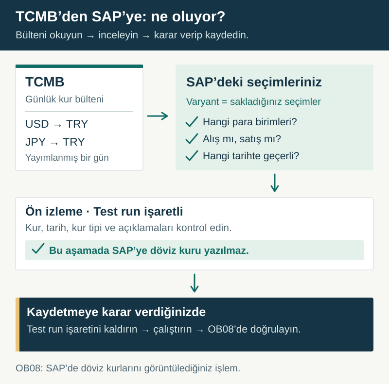

# TCMB kurlarını SAP'ye aktarın

> [English](README.md) | **Türkçe**

Türkiye Cumhuriyet Merkez Bankasının (TCMB) yayımladığı günlük döviz kurlarını SAP'ye almak istiyorsanız bu projeyi kullanabilirsiniz. Hangi para birimlerinin alınacağını, alış veya satış kurunun kullanılacağını ve kurların hangi tarihten itibaren geçerli olacağını siz belirlersiniz.

Önce sonucu **SAP'ye kaydetmeden** inceleyebilir, kontrol ettikten sonra aktarım yapabilir ve günlük çalışmayı SAP job'ı olarak planlayabilirsiniz.

## Başlamak için

**[Adım adım kurulum ve kullanım rehberini açın →](WALKTHROUGH.tr.md)**

Bu rehber, SAP'de SE38 üzerinden program çalıştırabilen ve geliştirme nesnelerini yönetebilen bir ABAP geliştiricisi içindir. FI bilgisi gereken kararları ve bağlantı yetkisi gerektiren işlemleri ayrıca açıklar. Bu yetkiler sizdeyse işlemleri kendiniz yapabilirsiniz; değilse ilgili ekiple tamamlayabilirsiniz.

**[SE38 kurulum dosyasını açın / kaydedin](https://raw.githubusercontent.com/Cheditte/abap-tcmb-rates/main/installer/zche_tcmb_install.prog.abap)** — SE38'de program adı `ZCHE_TCMB_INSTALL` olmalı. Dosyayı yüklemek için rehberi izleyin. Ayarlar için `ZCHE_TCMB_CONFIG`, günlük kullanım için `ZCHE_TCMB_LOAD` çalıştırılır.

**Tek dosyalı kurulum SAP deneme sisteminde ayrı test adlarıyla tamamlandı.** Kendi DEV ortamınızda da doğrulayın; mevcut nesneler varsa installer durur. [Test kapsamı](docs/validation-2026-11-02.md).

## Kurulumu üç adımda düşünün

| Adım | Ne yapacaksınız? | Sonunda ne hazır olacak? |
|---|---|---|
| **1. SAP'ye kurun** | Tek dosyalı kurulum programını SE38’de çalıştırıp kendi paketinizi seçin. | Çalıştırılabilir program ve ayar tabloları. |
| **2. Kurallarınızı belirleyin** | Para birimlerini, kur tipini ve geçerlilik tarihini bir profile kaydedin. SAP'nin TCMB'ye erişebildiğini kontrol edin. | Hangi kurların nasıl alınacağını belirleyen ayarlar. |
| **3. Deneyin ve kullanın** | Tek gün ve az sayıda para birimiyle yazmadan deneyin. Sonucu doğrulayıp kayıt yapın; ardından isterseniz job planlayın. | OB08 üzerinden kontrol edebileceğiniz SAP kur kayıtları. |

**Profil**, her çalıştırmada yeniden girmemek için kaydettiğiniz ayar grubudur. Programın adı **`ZCHE_TCMB_LOAD`**; SE38'den çalıştırırsınız. **OB08**, SAP'de döviz kuru kayıtlarını görüntüleyip bakımını yaptığınız işlem kodudur.

## Neye ihtiyacınız var?

- Geliştirme/deneme SAP sistemi ve nesne oluşturma yetkisi. **abapGit zorunlu değildir**; tek dosyalı SE38 kurulumu sunulur.
- SAP'de kullanılacak para birimleri, kur tipleri ve dönüşüm oranları. Seçimleri kendi FI/muhasebe sürecinize göre doğrulayın.
- SAP uygulama sunucusundan **`www.tcmb.gov.tr:443`** adresine HTTPS erişimi. Bilgisayarınızın siteyi açabilmesi SAP'nin de erişebildiğini göstermez.

**Normal HTTPS kullanımında SAP sunucusuna ayrıca bir yardımcı uygulama kurmanız gerekmez.** Bağlantı için ağ ve sertifika ayarı gerekebilir. İnternete çıkamayan SAP sistemlerinde, önceden sunucu klasörüne konulan XML dosyalarını okuyan [alternatif yol](WALKTHROUGH.tr.md#dosyadan-okuma) vardır; dosyaları hazırlama işlemi projeye dahil değildir.

## Kapsamı bilin

- Kurların karşılığı **TRY**'dir; proje farklı para birimleri arasında çapraz kur üretmez.
- Muhasebe belgesi oluşturmaz. SAP'nin standart döviz kuru kayıtlarını BAPI ile yükler.
- Test seçeneği varsayılan olarak açıktır. Testteki `NEW` / `UPDATED`, kayıt yapılırsa oluşacak sonucu gösterir.
- **Ön sürüm: v0.1.** Kurulum ve çalışma denemelerinin kapsamı [test kaydında](docs/validation-2026-11-02.md) açıklanır. 7.40 SP08 ve 7.58 için statik kontroller, eski SAP sürümlerinde çalışma garantisi değildir.

## Hangi belgeyi okuyayım?

| İhtiyacınız | Belge |
|---|---|
| Kurmak, ilk profili oluşturmak ve kullanmak | [Kurulum ve kullanım](WALKTHROUGH.tr.md) |
| Bütün ayarlar, sınıfları kendi kodunuzdan çağırma, genişletme ve hata davranışı | [Teknik başvuru](TECHNICAL.tr.md) |
| Test çalıştırmak veya katkı vermek | [CONTRIBUTING.md](CONTRIBUTING.md) — İngilizce |
| Değişiklikleri görmek | [CHANGELOG.md](CHANGELOG.md) — İngilizce |

MIT lisanslıdır. [Lisans](LICENSE) · [Hata bildirimi / öneri](https://github.com/Cheditte/abap-tcmb-rates/issues)
