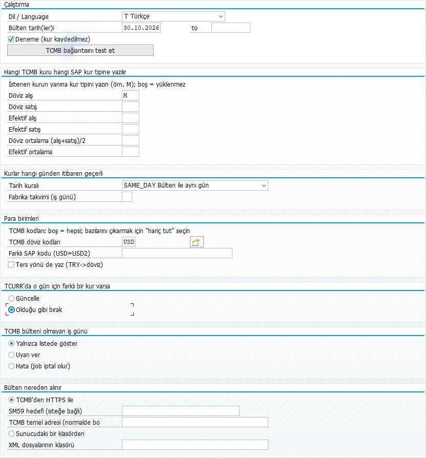
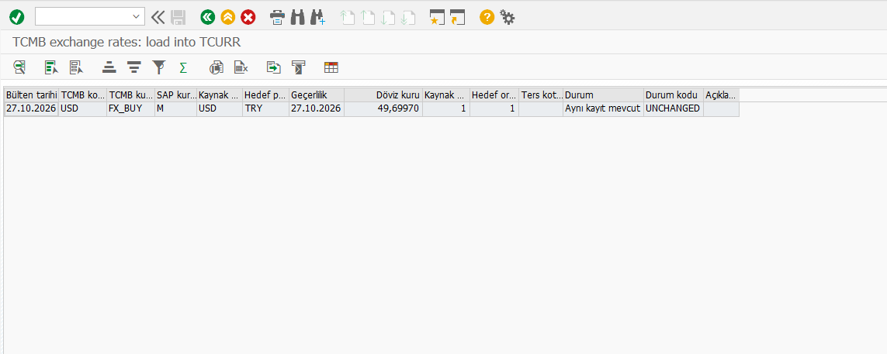

# Ekrandaki alanlar ne işe yarıyor?

> [Hedefe göre kullanım rehberi](WALKTHROUGH.tr.md) · [Proje özeti](README.tr.md) · [Teknik başvuru](TECHNICAL.tr.md)

İlk kez çalıştırıyorsanız önce [kaydetmeden deneme yolunu](WALKTHROUGH.tr.md#onizleme) izleyin. Bu belge, bir alanın anlamını veya başka bir seçeneği öğrenmek istediğinizde başvuracağınız açıklamadır.

Görsel v0.3.0 ekranıdır. Güncel kaynakta adres alanının adı **TCMB adresi (normalde boş)** olarak kısaltılmıştır.

## Çalıştırma: dil, tarih ve deneme

| Alan / düğme | Ne işe yarar? | Nasıl doldurulur? |
|---|---|---|
| **Dil / Language** | Bu programın alanlarını, kendi mesajlarını ve sonuç başlıklarını seçtiğiniz dilde gösterir. | **Türkçe** veya **English** seçin. **Otomatik / Logon language**, Türkçe SAP oturumunda Türkçe, diğer oturumlarda İngilizce kullanır. |
| **Bülten tarih(ler)i** | TCMB'den hangi günün bülteninin okunacağını belirler. | Tek gün için yalnız sol alanı doldurun. Aralık için sağa son günü girin; iki uç gün de aralığa dahildir. Cumartesi ve pazar atlanır. |
| **Deneme (kur kaydedilmez)** | Kurları okur, hesaplar ve SAP'deki mevcut kayıtlarla karşılaştırır; standart kur kaydı yapmaz. | İlk çalıştırmada **işaretli** bırakın. İşareti kaldırıp F8'e basmak gerçek kayıt yolunu çalıştırır. |
| **TCMB bağlantısını test et** | Seçilen kaynaktan yakın tarihli bir bültenin okunabildiğini sınar. | Düğmeye basın ve mesajı okuyun. Kur yazmaz; F8 ile yapılacak ön izlemenin yerine geçmez. |

## Hangi TCMB kuru hangi SAP kur tipine yazılır?

**Kurların karşılığı TRY olarak sabittir. Bu altı kutuya `34,50` gibi bir kur tutarı yazmayın.** Tutarı program TCMB'den alır. Siz, o tutarın SAP'de kullanılacağı **kur tipini** yazarsınız. Kur tipi, SAP'nin farklı amaçlarla kullanılan kurları ayırdığı anahtardır.

Örneğin **Döviz alış** yanına `M` yazmak, “TCMB'nin döviz alış değerini SAP'de M kur tipine al” demektir. Bu seçim `M` tipinin her kurumda döviz alış için kullanıldığı anlamına gelmez. Kendi sisteminizdeki FI kullanımını esas alın.

| Alan | Programın alacağı değer | İlk denemede |
|---|---|---|
| **Döviz alış** | TCMB'nin döviz alış değeri. | Örnekte `M`. |
| **Döviz satış** | TCMB'nin döviz satış değeri. | Boş bırakın. |
| **Efektif alış** | TCMB'nin nakit döviz için ayrı yayımladığı alış değeri. | Boş bırakın. |
| **Efektif satış** | TCMB'nin nakit döviz için ayrı yayımladığı satış değeri. | Boş bırakın. |
| **Döviz ortalama (alış+satış)/2** | Program döviz alış ve satış değerlerinin aritmetik ortalamasını hesaplar; iki değerin de bulunması gerekir. | Boş bırakın. |
| **Efektif ortalama** | Program efektif alış ve satış değerlerinin aritmetik ortalamasını hesaplar; iki değerin de bulunması gerekir. | Boş bırakın. |

**Boş alan o kur türünü yüklememek demektir.** En az birini doldurun. Birden fazla tür alacaksanız her birine farklı, sisteminizde tanımlı ve amacınıza uygun kur tipi girin. Aynı `M` değerini iki satıra yazmayın; program bunu reddeder.

## Kurlar hangi günden itibaren geçerli?

**Bülten tarihi**, veriyi aldığınız gündür. **Geçerlilik tarihi**, bu kurun SAP'de hangi günden itibaren kullanılacağıdır. Bu bölüm ikinci tarihi belirler; başka bir günün bültenini indirmez.

| Tarih kuralı | Ne yapar? | Örnek |
|---|---|---|
| **Bülten ile aynı gün** | SAP geçerlilik tarihi bülten tarihi olur. | 30.10.2026 bülteni → 30.10.2026 geçerlilik. İlk denemede bunu seçin. |
| **Ertesi takvim günü** | Geçerliliği bir sonraki güne alır; hafta sonu/tatil ayrımı yapmaz. | 30.10.2026 bülteni → 31.10.2026 geçerlilik. |
| **Sonraki iş günü (takvim)** | Bülten gününden sonraki ilk iş gününü seçtiğiniz SAP fabrika takviminden bulur. | Sonuç, takviminizde hangi günlerin iş günü olduğuna bağlıdır. |

**Fabrika takvimi (iş günü):** yalnız **Sonraki iş günü (takvim)** için doldurulur. SCAL'da tanımlı, sizin süreciniz için uygun takvimin kodunu kullanın. `TR` gibi bir kodun her sistemde hazır olduğunu varsaymayın. Diğer iki kuralda boş bırakın. Tarih kuralı başlangıçta boştur; listeden mutlaka seçin.

## Para birimleri: hangi dövizler, hangi yön?

| Alan | Ne işe yarar? | Nasıl doldurulur? |
|---|---|---|
| **TCMB döviz kodları** | Bültendeki hangi dövizlerin işleneceğini seçer. | İlk denemede `USD`. Birkaç kod için sağdaki **çoklu seçim** düğmesini açın; tekil değerler bölümüne `USD` ve `JPY` gibi kodları ayrı satırlarda yazıp onaylayın. Aralık bölümüne yazmayın. |
| **Farklı SAP kodu (USD=USD2)** | TCMB kodu ile SAP'deki kod farklıysa eşleştirir. | Normalde **boş**. Yalnız SAP'de gerçekten bu kod tanımlıysa `USD=USD2` gibi eşleme girin. Birden fazla eşlemeyi `;` ile ayırın. Bu işlem döviz dönüşümü yapmaz. |
| **Ters yönü de yaz (TRY→döviz)** | Döviz → TRY yönüne ek olarak TRY → döviz yönünü ters kotasyonla hazırlar. | İlk denemede **işaretsiz**. İki yönü de kullanmanız gerekiyorsa oranları ve SAP çevrim sonucunu ayrıca doğrulayın. |

**Döviz kodlarını boş bırakmak “hiçbir dövizi alma” değildir:** bültendeki bütün kodlar değerlendirilir. Çoklu seçimde hariç tutma da desteklenir. SAP'de tanımlı olmayan kodlar atlanır. İlk denemede kapsamı `USD` ile sınırlayın; daha sonra `JPY` eklediğinizde bültendeki 100 birim bilgisi ile OBBS oranlarını da inceleyin.

## SAP'de o gün için zaten kur varsa

**TCURR**, SAP'nin standart döviz kuru tablosudur; kayıtları **OB08** üzerinden kontrol edebilirsiniz. Program aynı kur tipi, para çifti ve geçerlilik tarihindeki kayda bakar.

| Seçenek | Farklı bir mevcut kur bulunursa |
|---|---|
| **Güncelle** | Gerçek çalıştırmada eski değeri yenisiyle değiştirir. Denemede yalnız değişikliği gösterir. Programın açılış varsayılanıdır. |
| **Olduğu gibi bırak** | Mevcut farklı değeri korur; satırı gerekçesiyle atlar. İlk denemede bunu seçin. |

**Olduğu gibi bırak, bütün kaydı kapatmaz:** aynı anahtarda kayıt yoksa gerçek çalıştırmada yeni kayıt eklenebilir. Hiç kur kaydetmemek için üstteki **Deneme (kur kaydedilmez)** kutusu işaretli olmalıdır. Mevcut kayıt zaten eşitse iki seçimde de `UNCHANGED` görülür.

## TCMB bülteni olmayan iş günü

Program hafta içi bir tarih için HTTPS kaynağından “bülten yok” yanıtı alırsa bu seçimi uygular. Örneğin tatil günü veya henüz yayımlanmamış bülten olabilir. Bu seçenek başka bir günün kurunu otomatik olarak kullanmaz.

| Seçenek | Ne olur? |
|---|---|
| **Yalnızca listede göster** | Bülten bulunamadığı sonuç listesinde belirtilir. İlk denemede bunu bırakın. |
| **Uyarı ver** | Sonuç kaydına ek olarak çalışma sonunda uyarı verilir. |
| **Hata (job iptal olur)** | Eksik bülten hata sayılır; arka plan işi hata ile sonlanır. |

Bu seçim ağ, sertifika, geçersiz XML veya okunamayan sunucu dosyası hatalarını yok saymaz. Tarih aralığındaki gerçek yazmalar satır satır yapılır; sonradan oluşan hata daha önce kaydedilmiş kurları geri almaz.

## Bülten nereden alınır?

**Normal kullanımda TCMB'den HTTPS ile seçili olsun; altındaki üç metin alanını boş bırakın.** Program TCMB adresini zaten bilir. Bağlantı düğmesiyle SAP sunucusundan erişimi sınayın.

| Alan / seçenek | Ne işe yarar? | Ne zaman doldurulur? |
|---|---|---|
| **TCMB'den HTTPS ile** | SAP uygulama sunucusu bülteni doğrudan internetten okur. | İlk denemede seçili bırakın. TCMB hesabı veya parola gerekmez. |
| **SM59 hedefi (isteğe bağlı)** | SAP'de önceden hazırlanmış HTTP bağlantısının ayarlarını kullanır. | Kurumunuz bu yolu kullanıyorsa gerçek SM59 hedef **adını** yazın. Buraya internet adresi yazılmaz. Normal doğrudan bağlantıda boş bırakın. |
| **TCMB adresi (normalde boş)** | Doğrudan TCMB HTTPS kök yolunu seçer. | Normalde boş. Yalnız https://www.tcmb.gov.tr ve alt yolları kabul edilir. Başka sunucu/iç ayna için Basis yönetimindeki SM59 hedefini kullanın. |
| **Sunucudaki bir klasörden** | İnternetten almak yerine önceden hazırlanmış XML dosyalarını okur. | HTTPS yerine dosya yolunu kullanacaksanız seçin; otomatik bir yedek kaynak değildir. |
| **XML dosyalarının klasörü** | Dosya kaynağının bulunduğu SAP uygulama sunucusu klasörüdür. | Yalnız klasörden okumada gerçek sunucu yolunu girin. Kendi bilgisayarınızın İndirilenler klasörü değildir. [Dosya hazırlama adımları](WALKTHROUGH.tr.md#dosyadan-okuma). |

## Sonuç listesinin sütunları

Bu örnek 27.10.2026 gününe aittir. UNCHANGED, SAP kaydı ile hesaplanan değerin eşit olduğunu belirtir.

| Sütun | Bu ekrandaki değer | Nasıl okunur? |
|---|---|---|
| **Bülten tarihi** | `27.10.2026` | Verinin ait olduğu TCMB bülten günü. |
| **TCMB kodu** | `USD` | Bültenden seçilen para birimi. |
| **TCMB kur alanı** | `FX_BUY` | Döviz alış seçilmiş. Bu teknik kod dil değişse de aynı kalır. |
| **SAP kur tipi** | `M` | Kurun SAP'de hangi tip altında değerlendirildiği. |
| **Kaynak para birimi** | `USD` | Dönüşümün başlangıç para birimi. |
| **Hedef para birimi** | `TRY` | Dönüşümün karşılık para birimi. |
| **Geçerlilik tarihi** | `27.10.2026` | Kurun SAP'de hangi günden itibaren geçerli olduğu. OB08'de bu tarihe bakın. |
| **Döviz kuru** | `49,69970` | Programın hesaplayıp SAP kaydıyla karşılaştırdığı değer. Bu örnekte doğrudan kotasyon ve 1:1 oranla **1 USD = 49,69970 TRY** anlamına gelir. |
| **Kaynak oranı / Hedef oranı** | `1 / 1` | Kurun kaç birim üzerinden uygulandığı. Başka bir dövizde, özellikle JPY'de, 1:1 olduğunu varsaymayın. |
| **Ters kotasyon** | Boş | Bu satır ters kotasyon kullanmıyor. |
| **Durum** | `Aynı kayıt mevcut` | Sonucun seçtiğiniz dilde açıklaması. |
| **Durum kodu** | `UNCHANGED` | SAP'deki mevcut kayıt hesaplanan kurla eşit. |
| **Açıklama** | Boş | Bu satırda ek açıklama yok. Atlanan veya hatalı satırlarda nedeni burada okuyun. |

Dar sütunlarda başlıklar ve tutarlar kısaltılabilir. Kontrol veya ekran görüntüsü için ilgili sütunu genişletin. `NEW` tek başına yeterli değildir: denemede planlanan işlemi, gerçek çalıştırmada başarılı yeni kaydı belirtir. [Kayıt ve OB08 kontrolü](WALKTHROUGH.tr.md#ilk-kayit).
