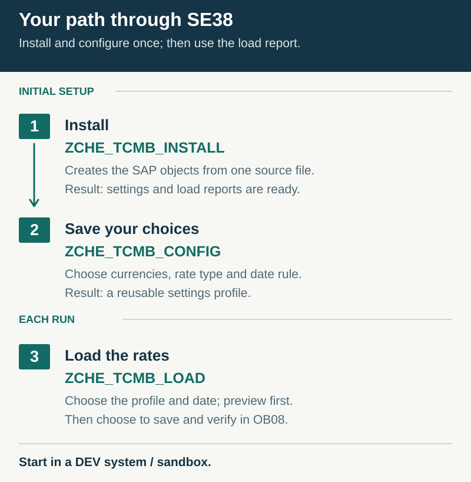
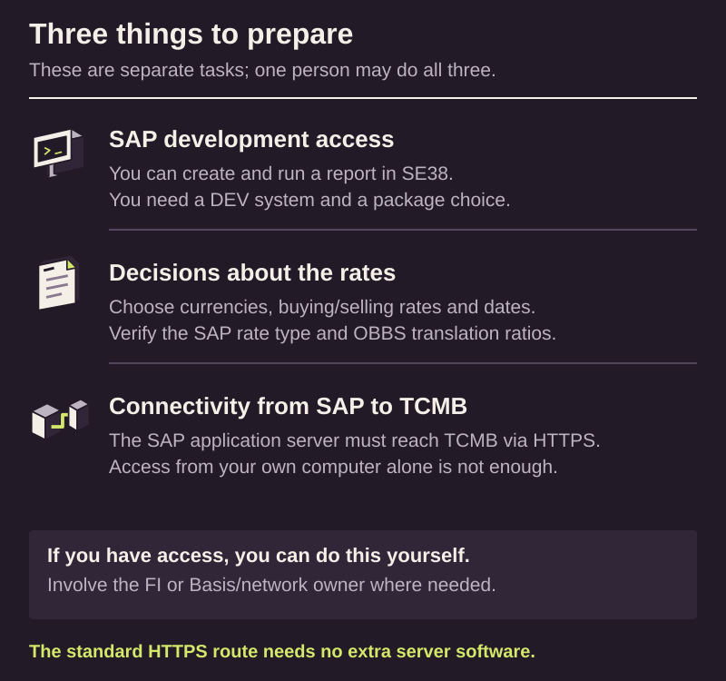

# Install one report and load your first rates

> **English** | [Türkçe](WALKTHROUGH.tr.md) · [Overview](README.md) · [Technical reference](TECHNICAL.md)

## Start with the big picture

SAP will read TCMB's daily bulletin. Choose the rates on the same report's screen, preview without saving, then choose to save and verify the records in **OB08**.

This guide is for an ABAP developer who can create and run reports in SE38. Start in DEV/a sandbox. [SAP acceptance](docs/validation-v0.3.0.md) for the v0.3.0 integration candidate remains incomplete.

Order: [0 · Prepare](#prepare) → [1 · SE38](#install) → [2 · Settings](#settings) → [3 · Preview](#preview) → [4 · Save](#first-write) → [5 · Daily use](#daily-use).

## 0. Complete three preparations

- **SAP access:** permission to create/activate a report. Use your Z/Y package and appropriate Workbench child task for a transportable installation. `$TMP` is available for a local-only trial; that object cannot be transported.
- **Rate choices:** decide currencies, buying/selling fields and valid-from dates. Choose the SAP rate type for your process; example `M` is not an accounting recommendation. Currencies and rate types must exist. Verify the pair/rate type and effective **OBBS** translation ratios. TCMB may quote JPY per 100 units; do not enter arbitrary `1:1` ratios.
- **Connectivity:** HTTPS from the SAP application server to `www.tcmb.gov.tr:443`, with certificate trust. No TCMB account/password or server helper software is needed. Configure it yourself if authorized, otherwise involve Basis/network support. A browser test on your computer alone is insufficient.

## 1. Load the single file in SE38

1. Open [`src/zche_tcmb_load.prog.abap`](src/zche_tcmb_load.prog.abap). Use **Copy raw file** to copy the complete source, or **Download raw file** to save the `.abap` file. Do not upload the GitHub HTML page.
2. In **SE38**, create **`ZCHE_TCMB_LOAD`**, type **Executable program**. A suitable title is `TCMB exchange rates`. Assign your customer package and Workbench task, or Local Object / `$TMP` for a local trial.
3. Replace the entire initial source with this file. Alternatively use **Utilities → More Utilities → Upload/Download → Upload** to load the `.abap` file.

4. Check syntax and activate with **Ctrl+F3**. Enable **Fixed point arithmetic** in report attributes; calculations require it. The abapGit alternative imports this attribute from metadata.
5. Run the embedded suite through **Program → Execute → Unit Tests**. The current source contains **44 tests**; this count does not mean they have passed in SAP. Resolve failures before a real-write trial.

**Long-line error:** the source contains lines longer than 72 characters. Check **Downwards-compatible line length (72)** in editor settings and **Force Line Length 72** under Upload/Download. Disable the 72-character restriction and reload; do not truncate source. Menu wording varies by SAP GUI release/language.

**Checkpoint:** `ZCHE_TCMB_LOAD` is active and F8 opens its selection screen. No separate installer, settings report or SE11/SE54/SM30 work is needed. Labels are generated in Turkish for a Turkish logon, otherwise English; no manual text-element entry is required. Record the complete message if initialization fails.

If an older report already exists, preserve its source, custom changes and variants before replacement; follow [the migration note](TECHNICAL.md#migration-from-the-old-edition). SAP GUI layout and fresh copy/paste installation still need acceptance for this integration candidate. The capture above illustrates only the general SE38 upload menu.

## 2. Make the first choices on the same screen

### 2.1. Start with a small example

Open **SE38 → `ZCHE_TCMB_LOAD` → F8**. These are trial choices; adjust them to your FI decisions.

| Field | What to do for the first trial |
|---|---|
| Bulletin date(s) (`S_DATE`) | One past weekday with a published bulletin. |
| Test run (`P_TEST`) | **Keep selected.** |
| Forex buying (`P_FXBUY`) | Example `M`; use an appropriate defined SAP rate type. |
| Other five rate fields | Leave blank initially. Do not assign one rate type to two TCMB fields. |
| Date rule (`P_RULE`) | Select **Same day as the bulletin**. A choice is required; there is no default. |
| Factory calendar (`P_CAL`) | Required only for **Next working day**; use your actual SCAL calendar. `TR` is not present in every system. |
| TCMB currency codes (`S_CURR`) | Limit the trial to `USD` and `JPY`, entered as individual rows in multiple selection. |
| Other SAP code (`P_MAP`) | Blank if codes match. `USD=USD2` applies only if that is your actual SAP code. |
| Currency of TCMB rates (`P_TARG`) | `TRY`; no conversion to another target is performed. |
| Also write reverse direction (`P_INV`) | Unselected initially. |
| Existing different rate | Select **Keep it (`R_KEEP`)** for the first trial. The program defaults to Update; check this explicitly. |
| Working day without a bulletin | **Only show it in the list (`R_NBLOG`)**. |
| Source | **From TCMB over HTTPS (`R_HTTP`)**. Leave destination/custom address blank unless your environment needs them. |

**An empty currency selection means all**, not none: every bulletin code is evaluated; currencies unknown to SAP are skipped. Exclusions and code renaming are supported. Use an explicit inclusion list initially. [All fields and date rules](TECHNICAL.md#selection-fields).

### 2.2. Save the choices as a variant

1. On the selection screen, use **Goto → Variants → Save as Variant** or the equivalent button; Ctrl+S is available in many GUI versions.
2. Choose a name such as `TCMB_TRIAL` and your own description. This example is not preinstalled.
3. Save. Select this variant on a later run to restore the same values.

**Checkpoint:** the choices can be reloaded. A variant is a standard SAP selection record; it writes neither custom profile tables nor OB08 rates. Step 5 makes the daily job's date dynamic.

## 3. Test connectivity and preview without saving

1. Click **Test the connection to TCMB**. It searches the last seven days for a recent bulletin; retrieval/parsing returns `Connection OK`. It ignores your date selection and does not write rates.
2. Check the single past date. Today's bulletin may not be available yet.
3. Keep **Test run selected**, then F8.
4. Review bulletin date, `VALID_FROM`, currency pair, rate type, ratios, status and messages in the ALV list. Account for units/ratios when comparing values such as JPY with the bulletin.

| Status | Meaning in a preview |
|---|---|
| `NEW` | A new rate is planned for a real run. |
| `UPDATED` | An existing rate would change. |
| `UNCHANGED` | An equal rate exists for that key/date. |
| `SKIPPED` | Read the reason: for example Keep existing or a missing TCMB field. |
| `NO_BULLETIN` | The HTTP source reported no bulletin for that weekday. Your policy can make this an error. |
| `ERROR` | Resolve the message before a real load. |

**Checkpoint:** you can see actual TCMB data; `NEW` in preview does not mean anything was saved in OB08. It does not establish write authorization or commit success. Custom `LCL_EXIT` code also runs in test mode; follow [the side-effect contract](TECHNICAL.md#local-classes-and-extensions).

If the connection fails

`https://www.tcmb.gov.tr/kurlar` is the actual default source. Do not replace it with a personal address.

- Direct HTTPS uses STRUST's SSL client **Anonymous** PSE. Verify the current actual certificate chain rather than relying on a fixed certificate name.
- For SM59/proxy use a type-**G** HTTP destination: host `www.tcmb.gov.tr`, port `443`, SSL active, path prefix empty. Configure your proxy and SSL PSE. Enter **your destination's name** in `P_DEST` and save the variant again.
- If you lack access, ask the Basis/network owner for outbound HTTPS and corresponding trust from the SAP application server.
- For SAP without internet access, use [server files](#read-from-files).

## 4. Verify a real write in the sandbox

1. Resolve errors/unexpected skips; verify rate type, valid-from date and expected currency conversion.
2. Before the first new-write trial, check OB08 for the same key/date. `UNCHANGED` does not prove this run wrote a new rate. Keep **Keep it** selected to preserve different existing rates.
3. With the same small selection, **clear Test run and press F8 when you intend to save**.
4. Verify a successful `NEW` / `UPDATED` result in **OB08 for the same rate type, currency pair and date**. Also verify the expected amount through SAP currency conversion.
5. Repeat the day; equal rates should return `UNCHANGED`.

**Real writes use standard TCURR.** Copying the report to another Z name does not isolate rate data. Perform real-write trials only in the authorized test environment.

## 5. Schedule daily use after acceptance

1. Transport the report through your customer package and normal process. Verify target connectivity, FI settings and runtime-user permissions.
2. Create a separate daily variant. In variant attributes select **D / Dynamic date → Current date** for `S_DATE`, rather than saving a fixed past day. Explicitly verify the Test run flag in a variant intended to save rates.
3. In **SM36**, create a job for `ZCHE_TCMB_LOAD` and this variant. Schedule after bulletin publication; verify SAP/job time zones.
4. Test with a restricted runtime user. Monitor **SM37**, job log and spool. Errors cancel the job; earlier successful writes remain.

Prepare variants in each target or use your standard variant transport procedure; there is no custom profile-table transport. Saturdays/Sundays are skipped; the selected policy controls missing weekday HTTP bulletins. Saved variants and dynamic-date SM36 scheduling still need SAP acceptance for this edition.

## Read from files

Use only if SAP cannot retrieve TCMB over HTTPS. The source is a folder readable by the **SAP application server**, not your computer's Downloads folder. An automatic downloader is not included.

Prepare server files

1. If authorized, access the server through approved RDP (Windows), SSH (Linux) or managed transfer; otherwise involve the server owner.
2. Stage complete XML files as `DDMMYYYY.xml`. **30 October 2026 is an example:** its file is `30102026.xml`. Use your chosen date and matching bulletin date inside the XML. Place only complete files in the readable folder.
3. Select **From a folder on the server (`R_FILE`)** and enter your real folder in **Folder of the XML files (`P_DIR`)**. Do not copy a fixed example path.
4. Verify OS/SAP read permissions and shared access across application servers/job hosts.
5. Preview the staged file's date. The connection button searches the last seven days; preview an older file by selecting its date directly.

**Missing/unreadable files are `ERROR`.** They do not prove a holiday. No automatic download or source fallback occurs.

## If you get stuck

| Symptom | First check |
|---|---|
| Cannot paste/upload source | 72-character restriction, complete source and report name. |
| Selection-screen initialization fails | Full message, `SELECTION_TEXTS_MODIFY`/`VRM_SET_VALUES` and system release. |
| Rate type/date rule requested | Enter at least one mapping and choose a date rule. |
| SSL/connection error | SAP host, network/proxy, STRUST and SM59. |
| TCURF/ratio error | Correct OBBS key and positive factors effective on the date. |
| File missing | Actual server folder, filename, complete XML and read access. |
| Write/job error | Results, OB08, SM37 log/spool; inspect SM13 after a commit error. |

Do not retry immediately. Reconcile any rates already written, resolve the cause and preview the affected range. [Partial writes and recovery](TECHNICAL.md#errors-and-reruns).

Optional: install with abapGit

Import the repository into your customer package, Pull and activate. Offline ZIP import is also available. abapGit imports report attributes and text elements; daily operation does not depend on it. Do not load the same report twice using both routes.

