# From installation to daily use

> **English** | [Türkçe](WALKTHROUGH.tr.md) · [Overview](README.md) · [Technical reference](TECHNICAL.md)

## Choose your goal

The report reads TCMB bulletins and compares selected rates with SAP records. **Test run checked: preview only. Clear it: the report can write exchange rates.** OB08 is where you verify the resulting records.

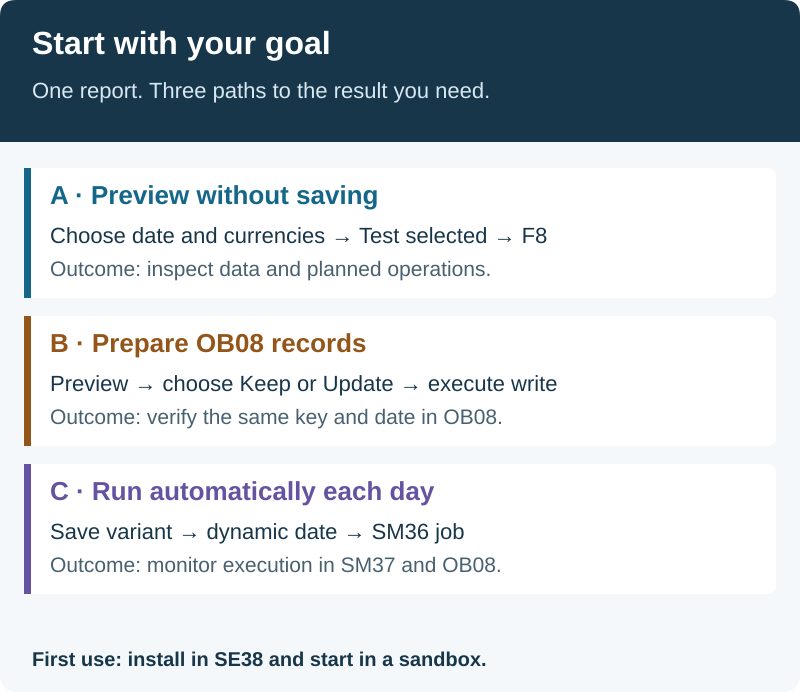

| Goal | Path | Completion check |
|---|---|---|
| Install | [Setup](#install) | Active report; selection screen opens. |
| Inspect without saving | [Path A](#preview) | Test checked; values/statuses listed. |
| Add or update records | [Path B](#first-write) | Result matches the same OB08 key/date. |
| Run daily | [Path C](#daily-use) | Dynamic-date variant, monitored job and spool. |

[Verified environments and pending checks](docs/validation.md). Perform first installation/write trials in DEV/test.

## Prepare three things

1. **SAP development access:** create/activate a report in SE38. Use your customer Z/Y package and Workbench task for transport. `$TMP` is for local trials and cannot be transported.
2. **FI choices:** decide currencies, SAP rate types and valid-from dates. Verify OBBS factors. The example `M` rate type is not a recommendation for every company.
3. **Connectivity:** outbound HTTPS from the SAP application server to `www.tcmb.gov.tr:443` and certificate trust in the SSL client PSE. Browser access on your laptop is insufficient; no helper software is installed on the server.

Prepare connectivity yourself if authorized; otherwise give Basis/network staff the SAP-host HTTPS requirement. For an internal mirror/proxy, use [SM59](#sources).

## Install once

1. Open the [single source file](src/zche_tcmb_load.prog.abap). Use **Copy raw file** or **Download raw file**; do not upload GitHub HTML.
2. Create `ZCHE_TCMB_LOAD` in **SE38**, type **Executable program**, in your package and Workbench task.
3. Replace all generated starter code with the complete source. Alternatively use **Utilities → More Utilities → Upload/Download → Upload**.
4. Enable **Fixed point arithmetic** in program attributes. Check syntax and activate with **Ctrl+F3**.
5. Run **Program → Execute → Unit Tests**, including all **55 embedded tests**. Resolve failures before write testing.
6. Execute with F8. Choose **Türkçe** or **English**; SAP standard menus retain their session language.

For long-line errors, disable **Downwards-compatible line length (72)** / **Force Line Length 72**, then reload the complete source. Do not truncate lines. For an existing installation, [preserve custom code and migrate variants](TECHNICAL.md#migration-from-the-old-edition). Optional abapGit import into a customer package is an alternative to manual SE38 upload.

## Path A — Preview without saving

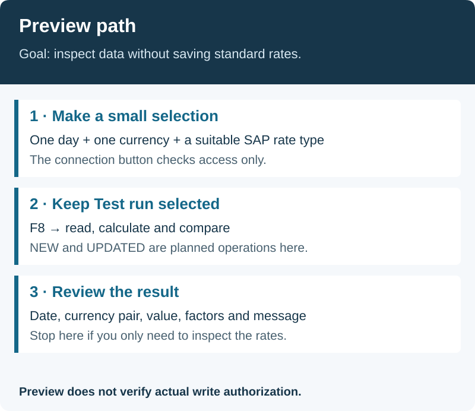

### A1. Select one day and one currency

Open the report through SE38/F8. Use an available bulletin day; the date below is an example.

| Field | First trial |
|---|---|
| Language | English or Türkçe |
| Bulletin date | `30.10.2026`; end date blank |
| Test run | **Checked** |
| Forex buying | A suitable existing SAP rate type; example `M` |
| Other five rate fields | Blank |
| Date rule | SAME_DAY; calendar blank |
| TCMB codes | `USD` |
| Code mapping / inverse | Blank / unchecked |
| Existing different rate | **Keep it** |
| Missing weekday bulletin | Only show it in the list |
| Source | HTTPS; destination/base URL/folder blank |

Rate mapping fields take **SAP rate types, not amounts**. The report gets amounts from TCMB; quotes are always against TRY. [Field reference](TECHNICAL.md#selection-fields).

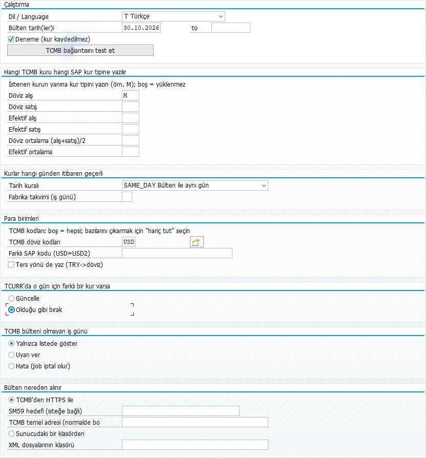

This screenshot shows v0.3.0; the current source shortens the Turkish URL label to **TCMB adresi (normalde boş)**.

### A2. Check connectivity

Choose **Test the connection to TCMB**. Read and acknowledge the message. This searches the last seven days, independently of your selected date. The currency count is not a count of saved records.

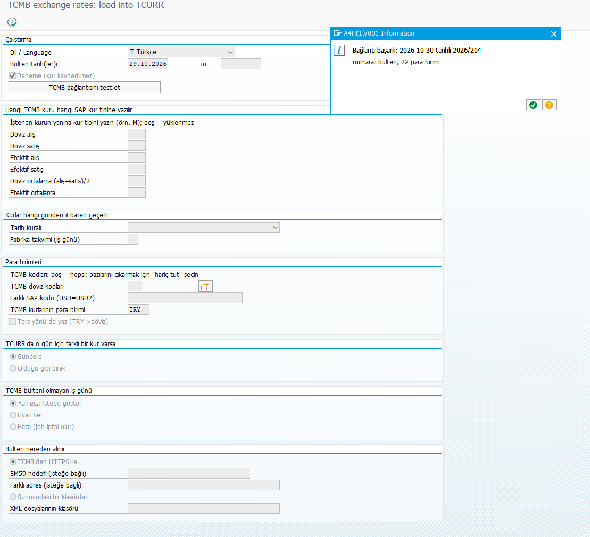

### A3. Execute and inspect

Keep **Test run checked**, press F8 and inspect rate type, pair, valid-from date, rate and factors.

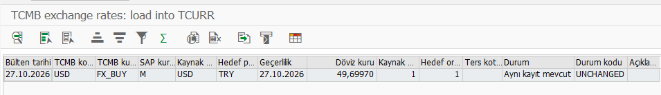

This result image is a separate example for 2026-10-27. Your list shows the day you selected.

| Status | Meaning in preview |
|---|---|
| NEW | A missing record is planned for insertion. |
| UPDATED | An existing different value is planned for replacement. |
| UNCHANGED | An equal record exists. |
| SKIPPED | Read the reason in Message. |
| NO_BULLETIN | No bulletin found for that day. |
| ERROR | Resolve before writing. |

After the small trial, add dates/currencies. Use the multiple-selection **Select Single Values** tab for individual codes; an empty currency filter evaluates every code. Saturdays/Sundays are skipped; both range endpoints are included.

## Path B — Write and verify OB08

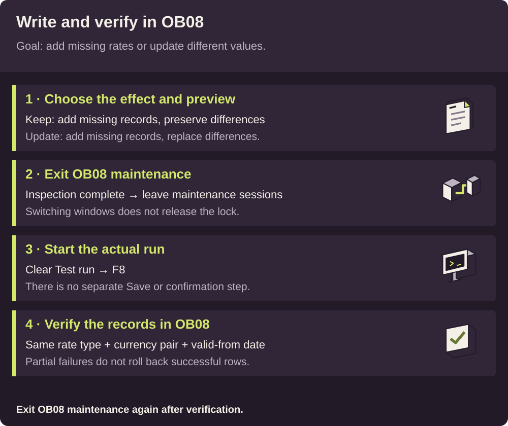

### B1. Choose existing-record behavior

| Intention | Choice |
|---|---|
| Add missing records and preserve different existing rates | **Keep it** |
| Add missing records and replace different existing rates | **Update it** |

Equal values return UNCHANGED either way. Keep does not disable all writes; **Test run** does.

### B2. Check first, then write

1. Complete Path A without unexplained errors/values. Note the rate type, currency pair and valid-from date.
2. Inspect that key in OB08, then **exit OB08 maintenance**. Leaving it open in another session does not release its lock.
3. Return to the report, check selections and **clear Test run**.
4. Press F8; actual writing begins without a separate Save/confirmation step.
5. Inspect results. NEW/UPDATED now report successful row writes. Failed rows do not undo earlier successful commits.

### B3. Verify independently

After the report finishes, open OB08 in the same system/client. Find **rate type + source currency + target currency + valid-from date**; use **Position** if needed. Compare rate, quotation and factors. No additional OB08 Save is needed.

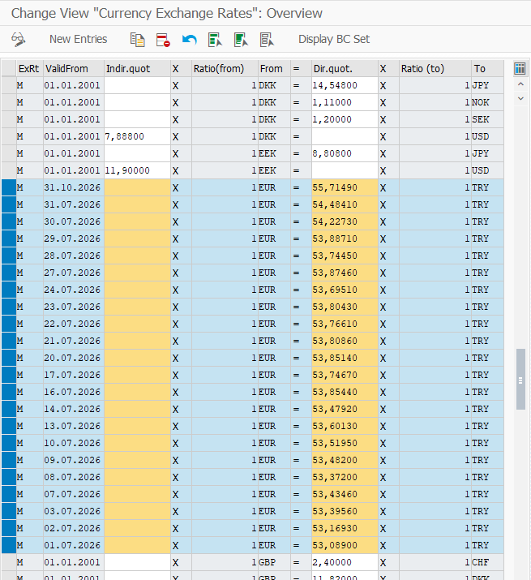

Exit maintenance, then rerun the report with **Test checked** and identical selections; equal rows should be UNCHANGED. Also verify standard SAP currency conversion for JPY/inverse quotation. [Calculation details](TECHNICAL.md#dates-and-ratios).

## Path C — Run automatically each day

**Flow:** selections → variant → SM36 job → SM37 log/spool. A variant stores settings; a job runs the report with those settings. First rehearse without writing.

### C1. Save a preview variant

Set language, mappings and currencies with **Test checked**. Use **Ctrl+S / Save as variant**, choose a new name such as `TCMB_PUB_TEST`, enter a description and save. Avoid overwriting an existing variant.

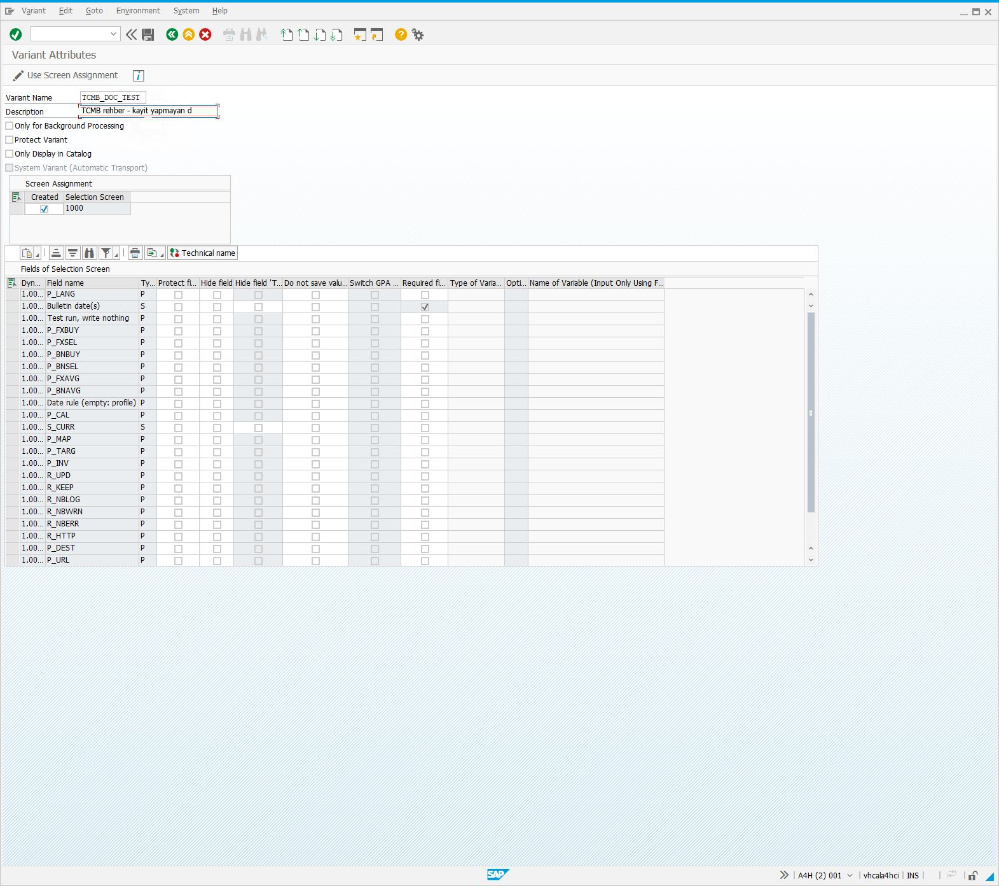

### C2. Make the date dynamic

1. In **Variant Attributes → Fields of Selection Screen**, locate the bulletin-date row. Choose **Technical name** if needed to identify `S_DATE`.
2. In that row's **Type of Variable** column, enter/select **D — Dynamic date calculation**.
3. Use F4 in the variable-name/options cell on the same row and select **Current date**.
4. Save and reload the variant. It should resolve to today's single date, with no fixed historical end date and Test still checked.

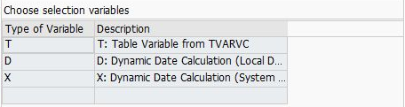

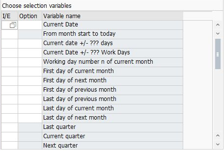

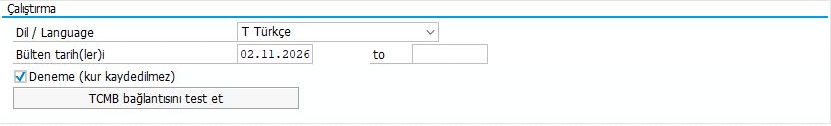

`DEFAULT sy-datum` alone does not make a saved variant dynamic; a fixed date can be stored. Dynamic date calculation is evaluated each run. Menu/column labels vary by SAP release/language.

### C3. Define the step in SM36

1. Open **/nSM36**, enter a distinct job name such as `ZTCMB_PUB_DYNAMIC_TEST`, normally class **C**. Follow any local server/class policy.
2. Choose **Step → ABAP program**, report `ZCHE_TCMB_LOAD`, and your saved variant.
3. Check the execution user's permissions. Store an explicit report language in the variant if required.
4. Save the step and return with F3; verify **1 Step(s) defined**.

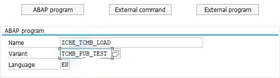

### C4. Rehearse once

Choose **Start condition → Immediate**, leave **Periodic Job unchecked**, save the condition, then save the main job. Check the **Released** confirmation.

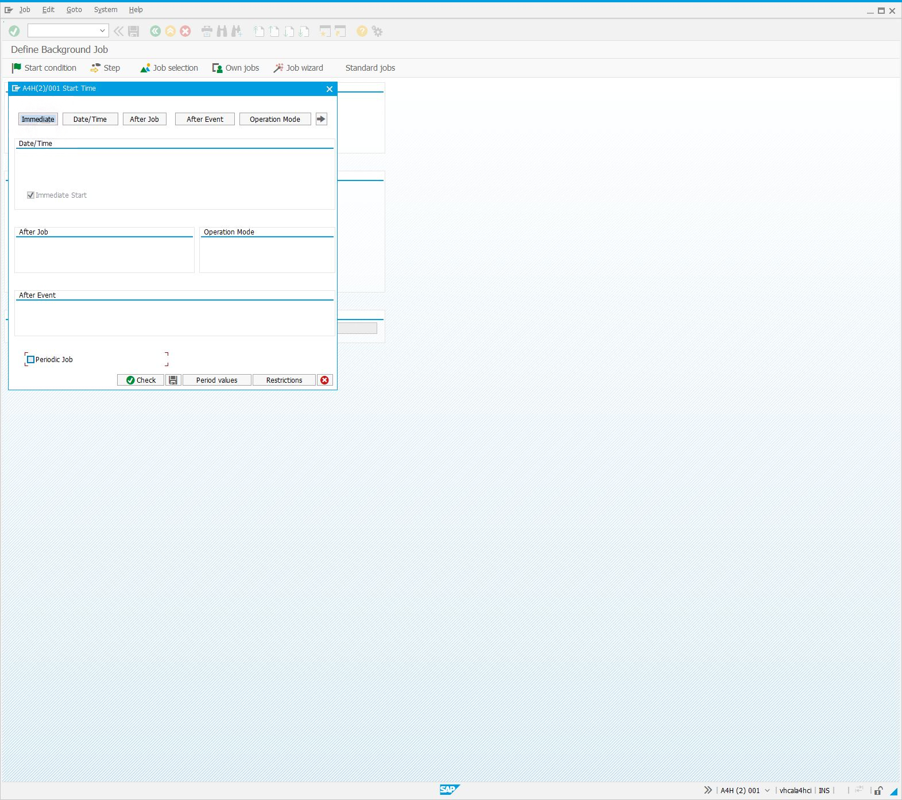

### C5. Monitor through SM37

1. Open **/nSM37**; filter by your job name, relevant user and execution day. Include Released/Ready/Active/Finished/Canceled, then execute. Include Scheduled when diagnosing an unreleased job.
2. Refresh. When Finished, select the row and open **Job log**; inspect the test summary and error count.
3. Return and open **Spool**. Select its row and choose **Display contents** to inspect result rows. Printing is unnecessary.

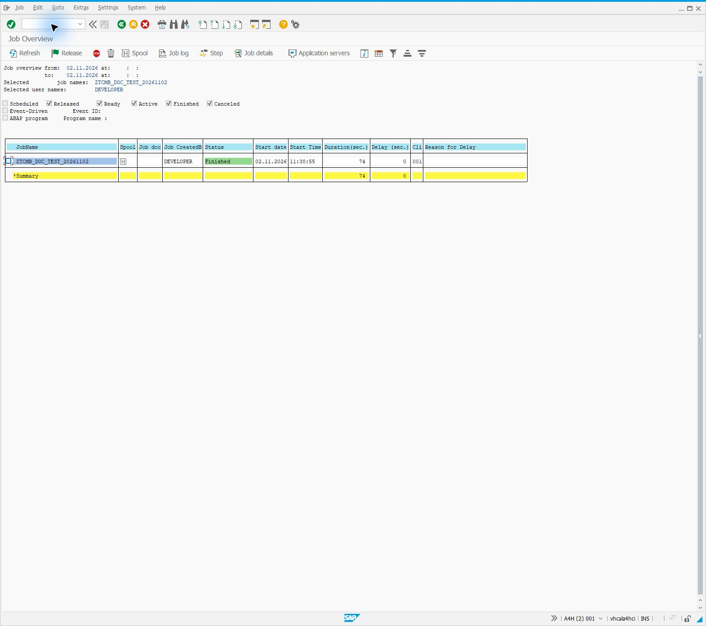

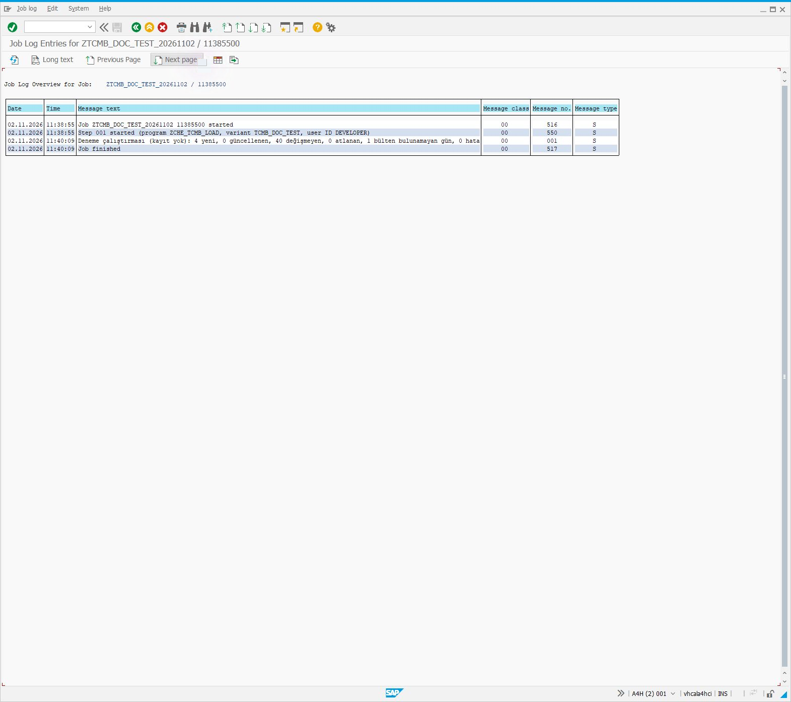

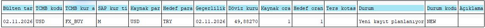

Finished alone does not prove that rates were written. A preview job only compares values; verify actual writes through OB08.

### C6. Enable daily writes after Path B acceptance

Create a separate daily variant, retain the dynamic current date, deliberately clear Test and select Keep/Update. Define another job in SM36:

1. **Start condition → Date/Time:** first execution date/time.
2. **Periodic Job → Period values → Daily:** daily recurrence.
3. Save the condition and main job; check Released in SM37.

Schedule after bulletin publication and verify the **SAP/job time zone**. Prepare the target system's variant, connectivity and execution user separately. Monitor the first daily runs through log/spool and OB08.

## Who needs which permissions?

| Task | Requirement |
|---|---|
| Installation | SE38 development/activation, package and transport access. |
| Preview | Report execution, reading standard rate/configuration data and source access. No write preflight in Test mode. |
| Writing | Change authorization for `V_TCURR`, typically `S_TABU_DIS` group `FB32`, `ACTVT=02`; verify TDDAT and your role design. |
| Server files | `S_DATASET` READ for the program/actual file path, plus OS read access. |
| Background job | Appropriate `S_BTCH_JOB`; `S_BTCH_NAM` when scheduling under another user. Execution user also needs source/write access. |

Give Basis/authorization staff the report name, actual folder, required V_TCURR change operation and job execution user. Do not request unrestricted SAP_ALL. The report checks once before real processing. **The BAPI already performs its own authorization checks**; the preflight avoids repeated row-level authorization errors.

## Direct HTTPS, SM59 or server files

Normally leave SM59 destination and TCMB base URL blank; the default is `https://www.tcmb.gov.tr/kurlar`. A supplied base URL must use `https://www.tcmb.gov.tr` or a path under that host. Spaces, `@`, query/fragment and other hosts are rejected; trailing slashes are removed.

For another host/internal mirror or a managed proxy, use a **Basis-managed SM59 type-G destination** with HTTPS/certificate/proxy settings. The report requests `/kurlar/YYYYMM/DDMMYYYY.xml`; a mirror must provide that path and complete TCMB XML. Enter the **destination name**, not its URL, in P_DEST.

### Read staged XML on the SAP server

1. If authorized, access the SAP application server through your approved RDP/SSH/file-transfer process; otherwise work with the server owner.
2. Stage complete daily XML as `DDMMYYYY.xml`: for example 30 October 2026 → `30102026.xml`, with the matching XML date.
3. Choose the server-folder source and enter the actual folder. This is not your laptop Downloads directory. `..` is rejected; repeated internal spaces are preserved.
4. Verify OS/SAP read permissions, test with the staged date and ensure every relevant job/application server can reach the folder.

Downloading/staging is outside this project. Missing/unreadable files are ERROR, not assumed holidays. There is no automatic source fallback.

## Recover from partial errors

1. Preserve the result/spool and exact messages. Commits are per row, so earlier successes remain.
2. Reconcile affected keys in OB08, then exit maintenance; open maintenance screens may hold locks.
3. If a lock persists, have its owner/administrator inspect the actual object/owner in SM12. Do not delete active locks as a generic fix.
4. After resolving the cause, preview affected dates/currencies with **Test + Keep**, then add missing entries through Path B.
5. Reconcile OB08 and SM13 before retrying a commit error.

For SSL issues check STRUST and server networking; for factors check OBBS; for configuration use the [field reference](TECHNICAL.md#selection-fields). [Error behavior](TECHNICAL.md#errors-and-reruns).
