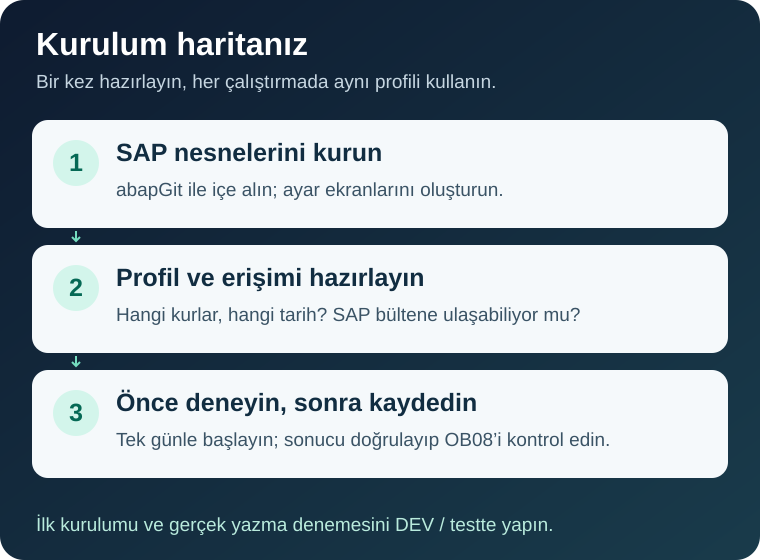

# Tek programla kurulum ve ilk kullanım

> [English](WALKTHROUGH.md) | **Türkçe** · [Proje özeti](README.tr.md) · [Teknik başvuru](TECHNICAL.tr.md)

## Önce büyük resim

SAP, TCMB'nin günlük kur bültenini okuyacak. Siz hangi kurları istediğinizi aynı programın ekranında seçeceksiniz. Önce sonucu kaydetmeden inceleyecek, sonra isterseniz kaydedip **OB08** üzerinden kontrol edeceksiniz.

Bu rehber SE38'de program oluşturup çalıştırabilen bir ABAP geliştiricisi içindir. İlk denemeyi DEV/deneme sisteminde yapın. v0.3.0 birleşim adayının [SAP kabul kontrolleri](docs/validation-v0.3.0.md) henüz tamamlanmadı.

Sıra: [0 · Hazırlık](#hazirlik) → [1 · SE38](#kurulum) → [2 · Seçimler](#ayarlar) → [3 · Ön izleme](#onizleme) → [4 · Kayıt](#ilk-kayit) → [5 · Günlük kullanım](#gunluk-kullanim).

## 0. Üç hazırlığı tamamlayın

- **SAP erişimi:** programı oluşturma/etkinleştirme yetkisi. Taşınabilir kurulum için kendi Z/Y paketinizi ve uygun Workbench alt görevinizi kullanın. Yalnız yerel deneme için `$TMP` seçebilirsiniz; bu nesne transport edilemez.
- **Kur seçimleri:** para birimlerini, hangi alış/satış alanını ve geçerlilik tarihini belirleyin. SAP kur tipi kullanım amacına göre seçilir; örnekteki `M` bir muhasebe önerisi değildir. Para birimleri ve kur tipi sistemde tanımlı olmalı. **OBBS**'de para çifti, kur tipi ve ilgili tarihteki dönüşüm oranlarını doğrulayın. TCMB, JPY'yi 100 birim üzerinden yayımlayabilir; rastgele `1:1` oran vermeyin.
- **Bağlantı:** SAP uygulama sunucusundan `www.tcmb.gov.tr:443` için HTTPS erişimi ve sertifika güveni. TCMB hesabı veya şifre gerekmez; sunucuya yardımcı uygulama kurmayacağız. Yetki sizdeyse kendiniz, değilse Basis/ağ sorumlusuyla hazırlayın. Bilgisayarınızdaki tarayıcı testi yeterli değildir.

## 1. Tek dosyayı SE38'e yükleyin

1. [`src/zche_tcmb_load.prog.abap`](src/zche_tcmb_load.prog.abap) dosyasını açın. **Copy raw file** ile bütün kaynak metnini kopyalayın veya **Download raw file** ile `.abap` dosyasını kaydedin. GitHub HTML sayfasını yüklemeyin.
2. **SE38**'de **`ZCHE_TCMB_LOAD`** adıyla program oluşturun. Tipi **Executable program / Çalıştırılabilir program** olsun. Başlık olarak `TCMB exchange rates` kullanabilirsiniz. Kendi müşteri paketinize ve Workbench task'ınıza kaydedin; yerel deneme için Local Object / `$TMP` seçebilirsiniz.
3. Oluşturulan başlangıç kaynağının tamamını yeni kaynakla değiştirin. Alternatif olarak **Utilities → More Utilities → Upload/Download → Upload** menüsünden `.abap` dosyasını yükleyin.

4. Sözdizimi kontrolünü yapıp **Ctrl+F3** ile etkinleştirin. Program özelliklerinde **Fixed point arithmetic / Sabit nokta aritmetiği** açık olmalı; kur hesabı için gereklidir. abapGit alternatifi bu özelliği metaveriden alır.
5. **Program → Execute → Unit Tests** üzerinden gömülü testleri çalıştırın. Güncel kaynakta **48 test** vardır; sayı, testlerin SAP'de geçtiği anlamına gelmez. Hata varsa ilk veri kaydına geçmeden inceleyin.

**Uzun satır hatası:** kaynakta 72 karakterden uzun satırlar vardır. Editör ayarlarındaki **Downwards-compatible line length (72)** ve Upload/Download menüsündeki **Force Line Length 72** seçeneklerini kontrol edin. 72 karaktere zorlamayı kapatıp dosyayı yeniden yükleyin; kodu kesmeyin. Menü adları SAP GUI sürümüne/diline göre değişebilir.

**Kontrol noktası:** `ZCHE_TCMB_LOAD` aktif ve F8 ile seçim ekranı açılıyor. Ayrı installer, ayar programı veya SE11/SE54/SM30 işlemi yoktur. Varsayılan **Otomatik / Logon language** dil seçimi Türkçe oturumda Türkçe, diğer oturumlarda İngilizce kullanır; **Dil / Language** alanından bunu değiştirebilirsiniz. Metin öğelerini elle doldurmanız gerekmez. Açılışta hata varsa tam mesajı kaydedin.

Mevcut programın eski sürümü varsa üzerine yüklemeden önce kaynağını, özel kodunu ve varyantlarını koruyun; [geçiş notunu](TECHNICAL.tr.md#eski-surumden-gecis) izleyin. Bu birleşim adayında yenilenen SAP GUI görünümü, dil seçiminin ekranı yenilemesi ve temiz kopyala-yapıştır kurulumu kabul testi bekliyor. Yukarıdaki görsel yalnız genel SE38 yükleme menüsünü gösterir.

## 2. Aynı ekranda ilk seçimleri yapın

### 2.1. Küçük bir örnekle başlayın

**SE38 → `ZCHE_TCMB_LOAD` → F8** ile ekranı açın. Aşağıdaki seçimler deneme örneğidir; kendi FI kararlarınıza göre uyarlayın.

**İngilizce oturumda Türkçe ekran için:** ilk bloktaki **Dil / Language** listesinden **Türkçe** seçin. Oturumdan çıkmanız gerekmez. Bu seçim programın alan ve sonuç başlıkları, tarih listesi, bağlantı/hata/satır mesajları ve çalışma özetinde kullanılır. SAP GUI'nin kendi menüleri ve SAP/BAPI/işletim sisteminin özgün teknik mesajları sistem/oturum dilinde kalabilir.

| Alan | İlk denemede ne yapacaksınız? |
|---|---|
| Dil / Language (`P_LANG`) | Türkçe için **Türkçe (`T`)**, İngilizce için **English (`E`)**. Varsayılan **Otomatik / Logon language (`A`)** oturum dilini izler. |
| Bülten tarih(ler)i (`S_DATE`) | Bülteni yayımlanmış geçmiş bir hafta içi günü; ilk seferde tek gün. |
| Test çalıştırma (`P_TEST`) | **İşaretli kalsın.** |
| Döviz alış (`P_FXBUY`) | Örnekte `M`; uygun ve tanımlı SAP kur tipinizi girin. |
| Diğer beş kur alanı | İlk denemede boş bırakın. Bir SAP kur tipini iki farklı TCMB alanına vermeyin. |
| Tarih kuralı (`P_RULE`) | Listeden **Bülten ile aynı gün** seçin. Alan zorunludur; varsayılan seçim yoktur. |
| Fabrika takvimi (`P_CAL`) | Yalnız **Sonraki iş günü** seçeneğinde kendi SCAL takviminiz gerekir. `TR` her sistemde hazır değildir. |
| TCMB döviz kodları (`S_CURR`) | İlk denemeyi sınırlamak için `USD` ve `JPY`. Çoklu seçimde ayrı tekil satırlara girin. |
| Farklı SAP kodu (`P_MAP`) | SAP kodları aynıysa boş. Örneğin `USD=USD2` yalnız sisteminizde gerçekten farklı kod varsa kullanılır. |
| TCMB kurlarının para birimi (`P_TARG`) | `TRY`; başka para birimine çevrim yapılmaz. |
| Ters yönü de yaz (`P_INV`) | İlk denemede işaretsiz. |
| Mevcut farklı kur | İlk denemede **Olduğu gibi bırak (`R_KEEP`)** seçin. Programın varsayılanı Güncelle'dir; bu seçimi özellikle kontrol edin. |
| Bülten olmayan iş günü | **Yalnızca listede göster (`R_NBLOG`)**. |
| Kaynak | **TCMB'den HTTPS ile (`R_HTTP`)**. SM59 hedefi ve farklı adres, kurumunuz gerektirmiyorsa boş. |

**Boş para birimi listesi “hiçbiri” demek değildir:** bültendeki bütün kodları değerlendirir; SAP'de tanımlı olmayanlar atlanır. Hariç tutma ve SAP kod eşlemesi desteklenir. İlk denemede açık bir dahil etme listesi kullanın. [Bütün alanlar ve tarih kuralları](TECHNICAL.tr.md#secim-alanlari).

### 2.2. Seçimlerinizi varyant olarak saklayın

1. Seçim ekranında **Goto → Variants → Save as Variant** veya ilgili **Varyant olarak kaydet** düğmesini kullanın; çoğu GUI'de Ctrl+S'dir.
2. Örneğin `TCMB_DENEME` adı ve kendi açıklamanızı girin. Bu örnek ad hazır gelmez.
3. Kaydedin. Sonraki çalıştırmada bu varyantı seçerek dil dahil aynı alanları doldurun. Oturum dilinden bağımsız Türkçe çıktı istiyorsanız varyantta **Türkçe** seçimini saklayın.

**Kontrol noktası:** seçimler yeniden yüklenebiliyor. Varyant yalnız SAP'nin standart seçim kaydıdır; özel profil tablolarına veya OB08'e kur yazmaz. Günlük işin tarihini 5. adımda dinamik yapacağız.

## 3. Bağlantıyı sınayın ve kaydetmeden çalıştırın

1. **TCMB bağlantısını test et** düğmesine basın. Son yedi gün içinde yakın tarihli bir bülteni alıp okuyabilirse seçtiğiniz dilde bağlantının başarılı olduğunu bildiren mesaj verir. Bu düğme seçtiğiniz tarih aralığını kullanmaz ve kur yazmaz.
2. Geçmiş tek gün seçiminizi kontrol edin. Bugünün bülteni henüz yayımlanmamış olabilir.
3. **Test çalıştırma işaretli kalsın**, F8'e basın.
4. ALV sonuç listesinde bülten tarihi, geçerlilik tarihi (`VALID_FROM`), para çifti, kur tipi, oranlar, durum ve açıklamayı inceleyin. Başlıklar ve ek durum açıklaması seçtiğiniz dildedir; `NEW`, `ERROR` gibi teknik durum kodları aynı kalır. TCMB değeriyle karşılaştırırken JPY gibi birim/oran etkisini dikkate alın.

| Durum | Test çalıştırmasında anlamı |
|---|---|
| `NEW` | Gerçek çalıştırmada yeni kayıt planlanıyor. |
| `UPDATED` | Gerçek çalıştırmada mevcut kurun değişmesi planlanıyor. |
| `UNCHANGED` | Aynı anahtar ve tarihte eşit kayıt var. |
| `SKIPPED` | Satır atlandı; nedeni mesajdadır. Mevcut kuru koruma veya eksik TCMB alanı olabilir. |
| `NO_BULLETIN` | HTTP kaynağı o hafta içi gün için bülten bulunmadığını bildirdi. Seçtiğiniz politika bunu hata da sayabilir. |
| `ERROR` | Sorunu mesajdan inceleyin; gerçek kayda geçmeyin. |

**Kontrol noktası:** gerçek TCMB verisini görüyorsunuz; testte `NEW` görmek OB08'e kayıt yapıldığı anlamına gelmez. Test modu gerçek yazma yetkisini veya commit başarısını doğrulamaz. Özel `LCL_EXIT` kodu eklediyseniz testte de çalışır; [yan etki kurallarını](TECHNICAL.tr.md#yerel-siniflar-ve-genisletme) uygulayın.

Bağlantı başarısızsa

Varsayılan adres `https://www.tcmb.gov.tr/kurlar` gerçek TCMB adresidir; kendi adresinizle değiştirmeyin.

- Doğrudan HTTPS, STRUST'taki SSL client **Anonymous** PSE'sini kullanır. Güncel ve gerçek sertifika zincirini doğrulayın; sabit bir sertifika adına dayanmayın.
- Kurumunuz SM59/proxy kullanıyorsa tip **G**, sunucu `www.tcmb.gov.tr`, port `443`, SSL etkin, path prefix boş bir HTTP hedefi hazırlayın. Proxy ve SSL PSE'sini ortamınıza göre ayarlayın. `P_DEST` alanına **sizin hedefinizin adını** girip varyantı yeniden kaydedin.
- Bu ayarlar sizde değilse Basis/ağ sorumlusuna SAP uygulama sunucusundan HTTPS erişimi ve sertifika güveni gerektiğini iletin.
- SAP internete çıkamıyorsa [dosyadan okuma](#dosyadan-okuma) yolunu kullanın.

## 4. Deneme sisteminde gerçek kaydı doğrulayın

1. Hata ve beklenmeyen atlamaları çözün; kur tipi, geçerlilik tarihi ve beklenen para çevrimini doğrulayın.
2. İlk yeni kayıt denemesinde OB08'de aynı anahtar/tarihte kayıt olup olmadığına bakın. `UNCHANGED`, bu çalıştırmanın yeni kayıt yaptığına kanıt değildir. Var olan farklı kuru değiştirmeden denemek için **Olduğu gibi bırak** seçimini koruyun.
3. Aynı küçük seçimle, **kaydetmek istediğinizde Test çalıştırma işaretini kaldırıp F8'e basın**.
4. Hatasız `NEW` / `UPDATED` sonucunu **OB08'de aynı kur tipi, para çifti ve geçerlilik tarihiyle** doğrulayın. SAP para çevrimiyle beklenen tutarı da kontrol edin.
5. Aynı günü tekrarlayın; eşit kayıtların `UNCHANGED` olması beklenir.

**Gerçek kayıt standart TCURR tablosuna gider.** Programı başka Z adıyla kopyalamak, kur verilerini ayrı bir alana taşımaz. Gerçek yazma denemesini yalnız yetkili deneme ortamında yapın.

## 5. Kabulden sonra günlük iş planlayın

1. Programı kendi paketiniz ve normal transport sürecinizle taşıyın. Her hedefte bağlantı, FI ayarları ve çalışma kullanıcısının yetkilerini doğrulayın.
2. Günlük kullanım için ayrı varyant oluşturun. Varyant özniteliklerinde `S_DATE` için **D / Dinamik tarih → Güncel tarih** seçin; sabit bir geçmiş günü kaydetmeyin. Yazacak varyantta Test çalıştırma seçimini ayrıca kontrol edin.
3. **SM36**'da `ZCHE_TCMB_LOAD` ve bu varyantla job oluşturun. Bültenin yayımlanmasından sonraya planlayın ve SAP/job saat dilimini doğrulayın.
4. Sınırlı yetkili çalışma kullanıcısıyla deneyin. **SM37**, job log'u ve spool üzerinden sonuçları izleyin. Hata job'ı `Cancelled` yapar; önceki başarılı kayıtlar geri alınmaz.

Varyantları hedef sistemde hazırlayın veya kurumunuzun standart varyant taşıma yolunu kullanın; özel profil tablosu transport'u yoktur. Türkçe job çıktısı için varyantta **Dil / Language → Türkçe** seçimini saklayın; **Otomatik / Logon language**, çalıştırma sırasında SAP'nin kullandığı dili izler. Cumartesi/pazar atlanır; hafta içi eksik HTTP bülteninin davranışını seçtiğiniz politika belirler. Kaydedilmiş dil seçimi, arka plan yerelleştirmesi ve dinamik tarihli SM36 yolu bu sürümde SAP kabul testi bekliyor.

## Dosyadan okuma

Yalnız SAP'nin TCMB'ye HTTPS erişimi yoksa kullanın. Program **SAP uygulama sunucusunun okuyabildiği klasörü** okur; kendi bilgisayarınızın İndirilenler klasörünü kullanmaz. Otomatik indirici projeye dahil değildir.

Sunucu dosyalarını hazırlama adımları

1. Yetkiniz varsa kurumunuzun izin verdiği RDP (Windows), SSH (Linux) veya yönetilen dosya aktarımıyla sunucuya erişin; yoksa sunucu sorumlusuyla hazırlayın.
2. Tam günlük XML'i `GGAAYYYY.xml` adıyla koyun. **30.10.2026 bir örnektir:** o günün dosyası `30102026.xml` olur. Kendi seçtiğiniz günün dosya adını kullanın; XML içindeki bülten tarihi de eşleşmeli. Okunan klasöre yalnız tamamlanmış dosyaları alın.
3. **Sunucudaki bir klasörden (`R_FILE`)** seçin; **XML dosyalarının klasörü (`P_DIR`)** alanına gerçek sunucu klasörünüzü girin. Sabit örnek klasör kopyalamayın.
4. İşletim sistemi ve SAP dosya okuma yetkilerini kontrol edin. Birden fazla uygulama sunucusunda job'ın aynı dosyalara ulaşabildiğini doğrulayın.
5. Dosyanın tarihiyle test çalıştırın. Bağlantı düğmesi son yedi güne bakar; yalnız eski bir dosyanız varsa o tarihte doğrudan test yapın.

**Eksik veya okunamayan dosya `ERROR` olur.** Bu, tatil kanıtı değildir. Kaynak değiştirme veya otomatik indirme yapılmaz.

## Bir adımda takılırsanız

| Belirti | İlk kontrol |
|---|---|
| Kaynak yapıştırılamıyor | 72 karaktere zorlama, tam kaynak ve doğru program adı. |
| Ekran açılışında hata | Tam hata mesajı; `SELECTION_TEXTS_MODIFY`/`VRM_SET_VALUES` ve sistem sürümü. |
| Kur tipi/tarih kuralı isteniyor | En az bir TCMB alanına kur tipi girin, tarih kuralını listeden seçin. |
| SSL veya bağlantı hatası | SAP sunucusu, ağ/proxy, STRUST ve SM59. |
| TCURF/oran hatası | OBBS'de doğru anahtar ve geçerlilik tarihindeki pozitif oranlar. |
| Dosya bulunamadı | Gerçek sunucu klasörü, dosya adı, tamamlanmış XML ve okuma izinleri. |
| Kayıt/job hatası | Sonuç, OB08, SM37 log/spool. Commit hatasında SM13 incelemesi. |

Çalışmayı doğrudan tekrarlamayın. Önce yazılmış olabilecek kurları kontrol edin; nedeni giderip etkilenen aralığı test modunda değerlendirin. [Kısmi yazma ve kurtarma](TECHNICAL.tr.md#hatalar-ve-yeniden-deneme).

İsteğe bağlı: abapGit ile kurulum

Depoyu müşteri paketinize alıp Pull/aktivasyon yapabilirsiniz. Çevrimdışı ZIP aktarımı da kullanılabilir. abapGit program özelliklerini ve metin öğelerini getirir; günlük çalışma ona bağlı değildir. Aynı programı iki yöntemle üst üste yüklemeyin.

