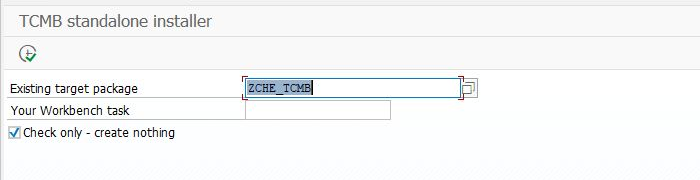
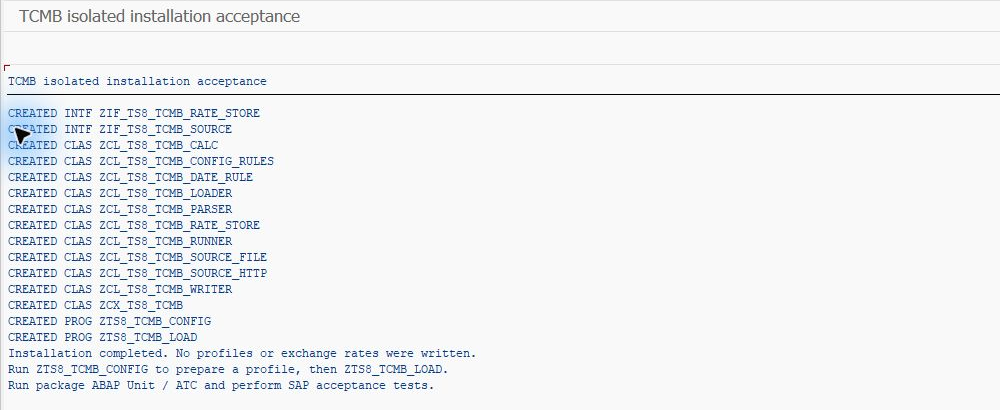
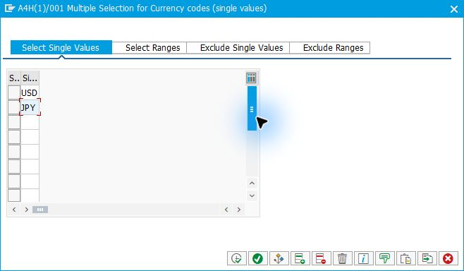
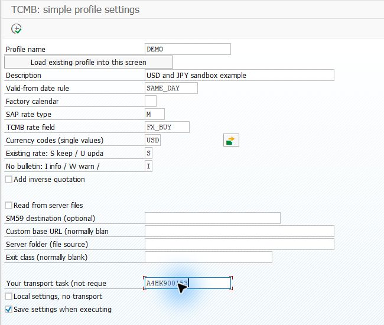

# Kurulum ve kullanım rehberi

> [English](WALKTHROUGH.md) | **Türkçe** · [Proje özeti](README.tr.md) · [Teknik başvuru](TECHNICAL.tr.md)

Bu rehberin sonunda `ZCHE_TCMB_LOAD` programını çalıştırıp seçtiğiniz bir günün TCMB kurlarını önce kaydetmeden inceleyebileceksiniz. Ardından deneme sisteminde kayıt yapıp sonucu OB08'de kontrol edeceksiniz.

**Başlangıç noktası:** SAP geliştirme yetkisi olan bir ABAP geliştiricisisiniz. İlk kurulumu DEV/deneme sisteminde yapın. Proje ön sürümdür; tamamlanan kurulum denemesi ve kalan kontroller [test kaydında](docs/validation-2026-11-02.md) açıklanır.

## Önce hazırlıkları ayırın

| Hazırlık | Nerede yapılır? | Ne için gerekir? |
|---|---|---|
| Projeyi içe aktarma ve ayar ekranları | SAP geliştirme sistemi | Installer ve ayar programını çalıştırmak. Bunu siz yaparsınız. |
| Para birimi, kur tipi, oran ve tarih kararı | SAP FI ayarları ve kendi muhasebe süreciniz | Doğru kurun doğru tarih ve kur tipiyle kaydedilmesi. Gerekirse FI sorumlusuyla belirleyin. |
| TCMB bağlantısı | SAP uygulama sunucusunun ağ ve SSL ayarları | SAP'nin bültene ulaşması. Yetki sizdeyse siz, değilse Basis/ağ sorumlusu yapar. |

Normal HTTPS yolunda sunucuya RDP/SSH ile bağlanıp ek yazılım kurmanız gerekmez. SAP GUI içindeki bağlantı/sertifika ayarları ve ağ izinleri yeterli olabilir. Sunucu erişimi yalnızca alternatif dosya yolu gibi ortamınızın gerektirdiği durumlarda gerekir.

## 1. SAP nesnelerini tek dosyayla kurun

Bu yol için abapGit kurmanız, her sınıfı elle oluşturmanız veya SE54'te ayar ekranı üretmeniz gerekmez. Installer gerekli nesneleri oluşturur; ayarlar ayrı bir SE38 programından girilir. Tek dosyalı kurulum ayrı test adlarıyla SAP deneme sisteminde tamamlandı. Kendi DEV ortamınızda ön kontrol ve kabul adımlarını yine uygulayın.

### 1.1. Paketi ve görevi hazırlayın

1. SE80'de transport edilebilir bir müşteri paketi oluşturun veya uygun mevcut paketi seçin. Örneğin `ZCHE_TCMB`; bu örnek ad yerine kendi **Z/Y paketinizi** kullanabilirsiniz.
2. SE09'da değiştirilebilir bir Workbench request altında **kendi kullanıcınıza ait geliştirme task'ını** hazırlayın. Installer'a ana request numarasını değil bu alt görevin numarasını gireceksiniz. Örnek transport numarası kopyalamayın; kendi sisteminizden seçin.

Yalnız yerel deneme için `$TMP` seçilebilir; bu durumda task alanı boş kalır. Sistemler arasında taşıyacaksanız müşteri paketi kullanın. Kurulum için nesne oluşturma/değiştirme ve CTS yetkileri gerekir.

### 1.2. Tek dosyayı SE38'e yükleyin

1. [Kurulum dosyasını açıp bilgisayarınıza kaydedin](https://raw.githubusercontent.com/Cheditte/abap-tcmb-rates/main/installer/zche_tcmb_install.prog.abap). İndirdiğiniz `zche_tcmb_install.prog.abap` dosyasının **tamamını** kullanın. Kaynak klasöründeki tek bir sınıfı veya GitHub HTML sayfasını yüklemeyin.
2. SE38'de **`ZCHE_TCMB_INSTALL`** adlı çalıştırılabilir program oluşturun. Aynı müşteri paketine/uygun transport görevinize kaydedin.
3. Kaynak düzenleyicisinde **Utilities → More Utilities → Upload/Download → Upload** ile dosyayı yükleyin; gerekirse tüm kodu kaynak alanına yapıştırın. Menü adları SAP diline göre değişebilir. Sözdizimi kontrolünü yapıp etkinleştirin. Kurulum programı bu aşamada TCMB projesinin başka nesnelerine ihtiyaç duymaz.
4. F8 ile çalıştırın. **Existing target package / P_PACK** alanına kendi paketinizi, **Your Workbench task / P_TASK** alanına kendi alt görevinizi girin.
5. **Check only - create nothing / P_TEST işaretli kalsın.** F8 ile ön kontrol yapın. `READY` satırlarını ve `Preflight passed` sonucunu arayın. Bu işlem nesne, profil veya kur kaydı oluşturmaz; gerçek kurulumun başarılı olacağını tek başına kanıtlamaz.
6. Ön kontrol başarılıysa seçim ekranına dönün; **yalnız kurulum yapmak istediğinizde** Check only işaretini kaldırıp F8'e basın. `Installation completed` sonucunu kontrol edin. Paket ABAP Unit ve uygun ATC kontrollerini çalıştırın.

**Installer temiz ilk kurulum içindir.** Aynı isimli aktif/pasif nesne varsa üzerine yazmadan durur; güncelleme veya otomatik onarım yapmaz. Yarıda kalırsa önceki nesneler oluşmuş olabilir. Log, SE11/SE24/SE38 aktivasyon durumları ve transport listesini inceleyin; nesneleri silerek veya korumayı kaldırarak tekrar denemeyin. Hatalı adım düzeltildikten sonra yetkili geliştiriciyle mevcut nesnelerin durumuna göre kurtarma yapın. Kurulum tek bir geri alınabilir işlem değildir.

**Bu bölümün sonucu:** `ZCHE_TCMB_CONFIG` ve `ZCHE_TCMB_LOAD` aktif olmalı. Kurulum profil veya döviz kuru yazmaz. Diğer sistemlere nesneleri normal transport süreciyle taşıyın; installer'ı her hedefte yeniden çalıştırmayın.

### Ekranda nasıl görünüyor?

**Dosyayı yükleme:** SE38 kaynak düzenleyicisinde bu menüyü açıp indirdiğiniz `.abap` dosyasını seçin.

**Ön kontrol:** önce Check only işaretli çalıştırın. Paket alanına kendi paketinizi girin; ekrandaki örnek adı kopyalamanız gerekmez. Task, SE09'daki kendi alt görevinizdir. Yalnız `$TMP` denemesinde boş bırakılır.

**Başarılı kurulumun sonunda:** `Installation completed` satırını arayın. Bu aşamada profil veya kur kaydı oluşmaz.

Görseller SAP GUI'den alınmıştır; tema ve menü dili sisteminizde farklı olabilir. Tamamlanma görüntüsündeki `ZTS8` adları mevcut projeyi korumak için kullandığımız test kopyasına aittir. Siz rehberdeki `ZCHE_TCMB_INSTALL`, `ZCHE_TCMB_CONFIG` ve `ZCHE_TCMB_LOAD` adlarıyla ilerleyin.

### Alternatif: abapGit

abapGit kullanmayı tercih ederseniz `https://github.com/Cheditte/abap-tcmb-rates` deposunu müşteri paketinize alıp Pull/aktivasyon yapabilirsiniz. İnternet erişimi olmayan kurulumda New Offline → Import zip → Pull zip yolu da vardır. Aynı nesneleri iki yöntemle üst üste kurmayın. Bu yolla da basit ayarlar için `ZCHE_TCMB_CONFIG` kullanılabilir; SM30 isteğe bağlı ileri bakım yoludur. [abapGit kurulum rehberi](https://docs.abapgit.org/user-guide/getting-started/install.html).

## 2. İlk profilinizi ve bağlantıyı hazırlayın

### 2.1. Önce hangi kuru alacağınızı seçin

Bu rehberdeki **`DEMO`**, sizin oluşturacağınız örnek profil adıdır; kurulumla otomatik gelmez. Örnek, USD ve JPY için döviz alış kurunu aynı gün geçerli olacak şekilde inceler. **`M`, `FX_BUY` ve `SAME_DAY` iş kuralı önerisi değildir**; kendi FI sürecinize göre seçin.

- **Kur tipi:** SAP'de farklı amaçlarla tuttuğunuz kur grubudur. Örnekte `M` kullanılır; sisteminizde tanımlı ve uygun olmalıdır.
- **TCMB alanı:** döviz alış, döviz satış, efektif alış/satış veya ortalama. Örnekte döviz alış için `FX_BUY` kullanılır. [Bütün seçenekler](TECHNICAL.tr.md#tcmb-alanları).
- **Geçerlilik tarihi:** bültenin tarihiyle aynı gün, ertesi gün veya fabrika takvimine göre sonraki iş günü olabilir. İlk örnekte `SAME_DAY` kullanılır.
- **Dönüşüm oranı:** SAP'nin kuru kaç birim üzerinden kullandığını belirler. Örneğin TCMB, JPY'yi 100 birim üzerinden yayımlayabilir. İlgili para çifti/kur tipi için OBBS'deki oranların geçerlilik tarihini de kapsadığını doğrulayın; rastgele `1:1` girmeyin.

### 2.2. Basit ayar ekranında profili kaydedin

1. **SE38 → `ZCHE_TCMB_CONFIG` → F8** ile ayar ekranını açın. `DEMO` hazır gelmez; şimdi oluşturacaksınız.
2. Aşağıdaki örneği kendi FI kararlarınıza göre doldurun. Ekran etiketleri İngilizcedir; alan adları parantez içindedir.

| Ekran alanı | İlk deneme |
|---|---|
| Profile name (`P_PROF`) | `DEMO` |
| Description (`P_DESC`) | Kendi açıklamanız |
| Valid-from date rule (`P_RULE`) | `SAME_DAY` |
| SAP rate type (`P_TYPE`) | Örnekte `M`; kendi uygun kur tipiniz |
| TCMB rate field (`P_SRC`) | Örnekte `FX_BUY` |
| Currency codes (`S_CURR`) | Çoklu seçimde tekil değerler olarak `USD` ve `JPY`; aralık/dışlama kullanmayın |
| Existing: S keep/U update (`P_KEEP`) | `S`: farklı mevcut kuru koru |
| No bulletin (I/W/E) (`P_NONE`) | `I`: sonuçta bildir |
| Your transport task (`P_TASK`) | SE09/SE10'daki kendi değiştirilebilir Customizing veya Workbench alt göreviniz |

3. İlk HTTPS denemesinde fabrika takvimi, ters yön, dosya kaynağı, SM59 hedefi, özel URL, klasör ve exit alanları boş/işaretsiz kalabilir. SM59 gerekiyorsa sonraki bölüme göre kendi hedefinizi girin. Karşılık para birimi `TRY` olarak kaydedilir.
4. **Save settings when executing (`P_SAVE`)** kutusunu işaretleyip F8'e basın. `Settings saved` sonucunu ve transport anahtarlarını kontrol edin. Bu işlem yalnız ayarları kaydeder; döviz kuru yazmaz.

Mevcut profili değiştirecekseniz önce adını girip **Load existing profile into this screen** düğmesine basın. Ekranı doldurmadan var olan profilin üzerine kayıt yapılamaz. Başkası siz düzenlerken değiştirdiyse yeniden yüklemeniz istenir. Birden fazla eşleme, dışlamalar veya farklı SAP para birimi kodları içeren profiller bu basit ekranda değiştirilmez; [ileri bakım yolunu](TECHNICAL.tr.md#advanced-profile-maintenance) kullanın.

**Yetki ve transport:** üç ayar tablosu için `S_TABU_NAM` görüntüleme (03) / değiştirme (02) yetkileri gerekir. Kapalı istemcide kayıt engellenir. Yalnız değişiklikleri otomatik kaydetmeden izin veren bir deneme istemcisinde **Local settings, no transport (P_LOCAL)** seçilip task boş bırakılabilir. Bu seçim taşıma yapmaz; günlük kullanım için müşteri paketiniz ve normal transport sürecinizle ilerleyin.

Para birimi listesi bu ekranda zorunludur. Boş bir ileri bakım tablosu ise bütün dışlanmamış bülten para birimlerini değerlendirebilir. İlk denemeyi sınırlı tutun.

### Ekrandaki örneği takip edin

Profil adını ve seçimlerinizi girin. Para birimlerinin yanındaki **çoklu seçim** düğmesiyle USD ve JPY'yi ayrı satırlara ekleyin. **Select Single Values** sekmesini kullanın; aralık veya dışlama seçmeyin.

Aşağıdaki görüntü **kaydetmeden önce doldurulmuş ekranı** gösterir; başarılı kayıt kanıtı değildir. Görseldeki transport numarasını kopyalamayın. Kendi task'ınızı seçin; istemciniz yalnız yerel değişikliğe izin veriyorsa Local settings seçip task'ı boş bırakın.

`S` mevcut farklı kuru korur, `U` güncellemeye izin verir. Bülten bulunamadığında `I` bilgi, `W` uyarı, `E` hata davranışıdır. Görüntüden sonra uzun alan etiketleri ekrana sığacak şekilde kısaltıldı; alan adları ve seçimler aynıdır.

### 2.3. SAP'nin bültene ulaşmasını sağlayın

Varsayılan kaynak adresi `https://www.tcmb.gov.tr/kurlar`'dır; kendinize ait bir adresle değiştirmeniz gerekmez. Bu yol için TCMB kullanıcı adı, şifre veya API anahtarı girilmez.

| Durum | Yapılacak işlem |
|---|---|
| SAP doğrudan internete çıkabiliyor | Profilde bağlantı alanları boş kalabilir. SAP'nin HTTPS ve sertifika güvenini doğrulayın. Doğrudan yol STRUST'taki SSL client **Anonymous** PSE'sini kullanır. |
| Kurum SM59 bağlantısı/proxy kullanıyor | SM59'da TCMB'ye HTTP hedefi (tip G), sunucu `www.tcmb.gov.tr`, port `443`, SSL etkin ve path prefix boş olacak şekilde hazırlayın. Profilin `RFC_DESTINATION` alanına **sizin oluşturduğunuz hedefin adını** girin. Ağ/proxy ve hedefin SSL PSE'si ortamınıza göre ayarlanır. |
| Bağlantı ayarlarını siz yönetmiyorsunuz | Basis/ağ sorumlusuna “SAP uygulama sunucusundan www.tcmb.gov.tr:443 için HTTPS erişimi ve sertifika güveni gerekiyor” bilgisini iletin. |
| SAP internet erişimine kapalı | Aşağıdaki [dosyadan okuma](#dosyadan-okuma) yolunu kullanın. |

Sertifika hatasında gerçek sertifika zincirini ve doğru PSE'yi kontrol edin. Bilgisayardaki tarayıcıyla erişim testi tek başına yeterli değildir.

**Bu bölümün sonucu:** profil ve iki para birimi kayıtlı; seçtiğiniz kaynak SAP'den erişilebilir olmalı.

## 3. Önce deneyin, sonra kaydedin

### 3.1. Yazmadan ilk kontrol

1. **SE38 → `ZCHE_TCMB_LOAD` → Execute (F8)** ile seçim ekranını açın.
2. **Rate profile / `P_PROF`** alanına `DEMO` girin.
3. **Test the connection to TCMB** düğmesine basın. Yakın tarihteki bir bülteni alıp okuyabilmesi kaynak bağlantısını doğrular; SAP'ye kur yazmaz. Bu test son yedi gün içinde bülten arar ve seçtiğiniz tarih aralığını kullanmaz.
4. **Bulletin date(s) / `S_DATE`** alanına bülteni yayımlanmış geçmiş bir hafta içi günü girin. İlk denemede tek gün seçin. Varsayılan bugün, henüz yayımlanmamış bir bülten olabilir.
5. **Date rule / `P_RULE`** boş kalsın; profilin kuralı kullanılır. **Test run, write nothing / `P_TEST` işaretli kalsın.**
6. F8 ile çalıştırın. Sonuçtaki bülten tarihi, `VALID_FROM`, USD/JPY, kur tipi, oranlar ve açıklamaları kontrol edin. Bülten değeriyle SAP kurunu birim/oran etkisini dikkate alarak karşılaştırın.

| Sonuç | Nasıl okuyacaksınız? |
|---|---|
| `NEW` | Testte: yeni kayıt oluşturulacak. Gerçek çalıştırmada: yazma ve commit başarılıysa yeni kayıt oluştu. |
| `UPDATED` | Testte: mevcut kayıt değiştirilecek. Gerçek çalıştırmada: yazma ve commit başarılıysa güncellendi. |
| `UNCHANGED` | Aynı anahtar/tarihte eşit kur zaten var. |
| `SKIPPED` | Satır atlandı; nedenini mesajda okuyun. Mevcut kaydı koruma veya eksik kaynak alanı olabilir. |
| `NO_BULLETIN` | Seçilen hafta içi gün için bülten alınamadı; örneğin tatil veya henüz yayınlanmama. Profil politikası hata da üretebilir. |
| `ERROR` | Sorun var; mesajı inceleyip çözün. |

**Testte `NEW` görmeniz OB08'e kayıt yapıldığı anlamına gelmez.** Bu mod yazma yetkisini veya gerçek kaydın başarısını da doğrulamaz. Kendi exit sınıfınızı eklerseniz testte de çalışır; [test kurallarına](TECHNICAL.tr.md#mimari-ve-genişletme) uymalıdır.

### 3.2. Deneme sisteminde gerçek kayıt

1. Beklenmeyen hata/atlamaları çözün. Kur tipi, geçerlilik tarihi ve beklenen çevrim tutarını doğrulayın.
2. Aynı sınırlı seçimle, **yalnızca kayıt yapmak istediğinizde** Test run işaretini kaldırıp çalıştırın.
3. **OB08**'de aynı kur tipi, para çifti ve geçerlilik tarihiyle kaydı bulun. SAP para çevrimiyle beklenen tutarı da kontrol edin.
4. Aynı günü tekrar çalıştırın: kaydedilmiş eşit kurların `UNCHANGED` olması beklenir.

### 3.3. Günlük çalışmayı planlayın

Kurulum ve gerçek yazma kabulü tamamlandıktan sonra nesneleri ve profil verilerini normal transport sürecinizle taşıyın. Her hedef sistemde istemci, bağlantı, yetki ve FI ayarlarını ayrıca doğrulayın.

**SM36**'da `ZCHE_TCMB_LOAD` için onayladığınız seçimlerle bir varyant ve job hazırlayın. Günlük bülten için tarih alanını sabit bir gün olarak kaydetmeyin; **güncel tarih seçim değişkeni** kullanın. Yazması gereken varyantta Test run işaretini ayrıca kontrol edin. Önce test kullanıcısıyla arka plan çalışmasını doğrulayın; ardından yetkileri uygun çalışma kullanıcısını seçin.

TCMB, gösterge kurlarını iş günlerinde saat 15.30'da ilan eder; job'ı yayın sonrası uygun bir saate planlayın ve SAP/job saat dilimini doğrulayın. [TCMB açıklaması](https://tcmb.gov.tr/wps/wcm/connect/TR/TCMB%2BTR/Main%2BMenu/Banka%2BHakkinda/Sikca%2BSorulan%2BSorular/Doviz%2BKuru%2BPolitikasi%2Bve%2BRezerv%2BYonetimi/).

Program cumartesi/pazarı atlar. Tatil veya yayınlanmamış günün davranışı profil ayarına bağlıdır. **SM37**, job log'u ve spool üzerinden sonuçları izleyin; hatalı job önceki başarılı kayıtları geri almaz.

## Dosyadan okuma

Bu bölüm yalnız SAP'nin TCMB'ye HTTPS erişimi yoksa gerekir. Program bilgisayarınızdaki İndirilenler klasörünü değil, **SAP uygulama sunucusunun okuyabildiği klasörü** kullanır. Otomatik indirici bu projeye dahil değildir.

1. Yetkiniz varsa sunucuya kurumunuzun izin verdiği yöntemle (Windows'ta RDP, Linux'ta SSH veya yönetilen dosya aktarımı) erişin; yoksa sunucu sorumlusuyla klasör ve dosya hazırlığını yapın.
2. Tam TCMB günlük XML'ini bu klasöre `GGAAYYYY.xml` adıyla koyun. Örneğin **30.10.2026 için** `30102026.xml`; kendi seçtiğiniz tarihe göre dosya adı değişir. XML içindeki bülten tarihi de aynı olmalıdır. Dosya tamamlandıktan sonra okunacak klasöre alın.
3. Profilde `SOURCE_CLASS = ZCL_CHE_TCMB_SOURCE_FILE` yapın. `FILE_FOLDER` alanına **sizin sisteminizdeki gerçek sunucu klasörünü** girin. Birden fazla uygulama sunucusu varsa çalıştırmanın/job'ın aynı dosyalara erişebildiğini doğrulayın.
4. SAP çalışma kullanıcısının dosya yetkisini ve sunucudaki okuma iznini kontrol edin. Tek günlük test çalıştırmasını seçtiğiniz dosyanın tarihiyle yapın.

Bağlantı düğmesi dosya kaynağında da son yedi güne bakar. Sadece daha eski bir dosya hazırladıysanız düğme yerine o tarihte test çalıştırması yapın. Eksik/okunamayan dosya `ERROR` olur; program bunu “TCMB o gün yayın yapmadı” diye kabul etmez ve başka kaynağa otomatik geçmez.

## Bir şey ters giderse

| Belirti | İlk kontrol |
|---|---|
| Profil bulunamıyor | Doğru istemci, profil adı ve üç ayar tablosu. |
| Ayar kaydı engelleniyor | S_TABU_NAM yetkileri, SCC4 istemci ayarı, kendi transport task’ınız ve mevcut profili önce yükleme. |
| SSL / bağlantı hatası | SAP sunucusunun erişimi, STRUST/SM59, ağ ve proxy. |
| Oran / TCURF hatası | OBBS'de doğru para çifti, kur tipi ve geçerlilik tarihindeki oranlar. |
| Beklediğiniz kur atlandı | Satır mesajı, para birimi listesi, kaynak alanı ve mevcut kayıt politikası. |
| Job hata verdi | SM37 log/spool ve OB08. Daha önce yazılmış kayıtlar kalmış olabilir. |

**Hata alan çalıştırmayı körlemesine tekrarlamayın.** Başarılı önceki günler ve satırlar kaydedilmiş olabilir. Önce sonuçları ve OB08'i inceleyin; nedeni giderip etkilenen aralığı test modunda tekrar değerlendirin. Commit hatasında yeniden denemeden önce SM13'teki başarısız/bekleyen güncellemeleri yetkili kişiyle kontrol edin. [Kısmi yazma ve kurtarma ayrıntıları](TECHNICAL.tr.md#hatalar-kısmi-yazma-ve-yeniden-çalıştırma).
