# TCMB kurları: hedefinize göre kullanım rehberi

> [English](WALKTHROUGH.md) | **Türkçe** · [Proje özeti](README.tr.md) · [Alanların açıklaması](EKRAN_REHBERI.tr.md)

## Önce ne yapmak istediğinizi seçin

Tek program TCMB bültenini okur, seçtiğiniz kurları hesaplar ve SAP'deki mevcut değerlerle karşılaştırır. **Deneme kutusu işaretliyse sonuçları görürsünüz; işareti kaldırırsanız program kur kaydı yapabilir.** OB08, kayıtların kontrol edildiği SAP ekranıdır.

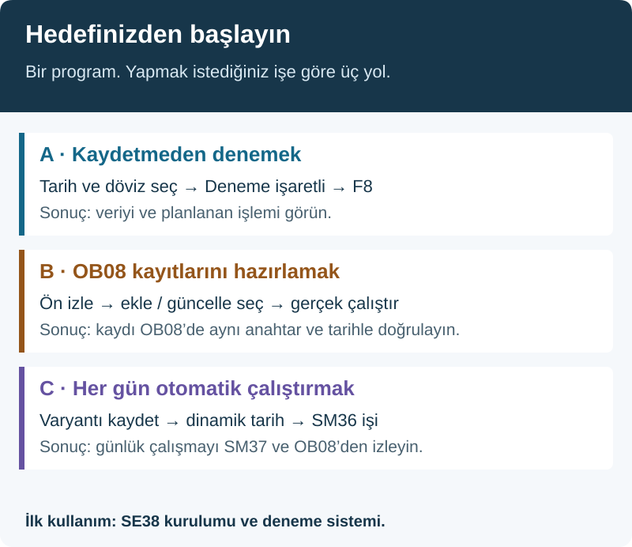

| Hedefiniz | İzleyeceğiniz yol | Tamamlandığını nasıl anlarsınız? |
|---|---|---|
| **Yalnızca veriyi görmek / test etmek** | [Yol A — Kaydetmeden deneme](#onizleme) | Kur ve durumlar sonuç listesinde; Deneme işaretli. |
| **OB08'e eksik kur eklemek veya mevcut kuru güncellemek** | [Yol B — Gerçek kayıt](#ilk-kayit) | Sonuç ile OB08'deki aynı tarih/kur tipi/para çifti eşleşiyor. |
| **Her gün otomatik çalıştırmak** | [Yol C — Günlük iş](#gunluk-kullanim) | Dinamik tarihli varyant ve izlenen SM36/SM37 işi. |
| **Bir alanı anlamak** | [Ekran rehberi](EKRAN_REHBERI.tr.md) | Alanın amacı, örnek değeri ve ne zaman boş bırakılacağı. |
| **Kilit veya kısmi kayıt hatasını çözmek** | [Sorun çözme yolu](#kilit-ve-kismi-kayit) | Başarılı kayıtlar korunuyor; etkilenen satırlar yeniden doğrulanıyor. |

Program kurulu değilse aşağıdaki hazırlık ve kurulumla başlayın. Kuruluysa doğrudan hedefinize geçebilirsiniz. İlk gerçek denemeyi DEV/deneme sisteminde yapın. [Güncel doğrulama durumu](docs/validation-v0.3.0.md).

## Başlamadan önce: üç hazırlık

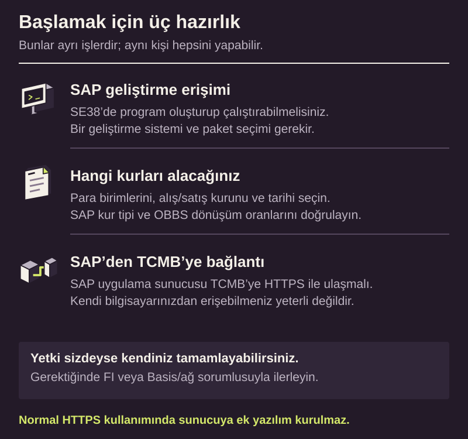

- **SAP erişimi:** programı oluşturma/etkinleştirme yetkisi. Taşınabilir kurulum için kendi Z/Y paketinizi ve uygun Workbench alt görevinizi kullanın. Yalnız yerel deneme için `$TMP` seçebilirsiniz; bu nesne transport edilemez.
- **Kur seçimleri:** para birimlerini, hangi alış/satış alanını ve geçerlilik tarihini belirleyin. SAP kur tipi kullanım amacına göre seçilir; örnekteki `M` bir muhasebe önerisi değildir. Para birimleri ve kur tipi sistemde tanımlı olmalı. **OBBS**'de para çifti, kur tipi ve ilgili tarihteki dönüşüm oranlarını doğrulayın. TCMB, JPY'yi 100 birim üzerinden yayımlayabilir; rastgele `1:1` oran vermeyin.
- **Bağlantı:** SAP uygulama sunucusundan `www.tcmb.gov.tr:443` için HTTPS erişimi ve sertifika güveni. TCMB hesabı veya şifre gerekmez; sunucuya yardımcı uygulama kurmayacağız. Yetki sizdeyse kendiniz, değilse Basis/ağ sorumlusuyla hazırlayın. Bilgisayarınızdaki tarayıcı testi yeterli değildir.

## İlk kurulum: bir kez yapın

1. [`src/zche_tcmb_load.prog.abap`](src/zche_tcmb_load.prog.abap) dosyasını açın. **Copy raw file** ile bütün kaynak metnini kopyalayın veya **Download raw file** ile `.abap` dosyasını kaydedin. GitHub HTML sayfasını yüklemeyin.
2. **SE38**'de **`ZCHE_TCMB_LOAD`** adıyla program oluşturun. Tipi **Executable program / Çalıştırılabilir program** olsun. Başlık olarak `TCMB exchange rates` kullanabilirsiniz. Kendi müşteri paketinize ve Workbench task'ınıza kaydedin; yerel deneme için Local Object / `$TMP` seçebilirsiniz.
3. Oluşturulan başlangıç kaynağının tamamını yeni kaynakla değiştirin. Alternatif olarak **Utilities → More Utilities → Upload/Download → Upload** menüsünden `.abap` dosyasını yükleyin.

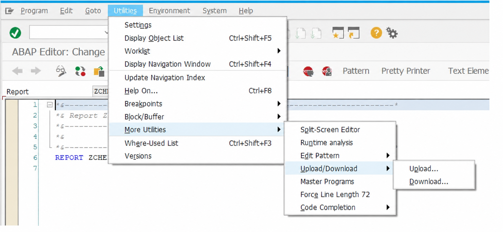

4. Sözdizimi kontrolünü yapıp **Ctrl+F3** ile etkinleştirin. Program özelliklerinde **Fixed point arithmetic / Sabit nokta aritmetiği** açık olmalı; kur hesabı için gereklidir. abapGit alternatifi bu özelliği metaveriden alır.
5. **Program → Execute → Unit Tests** üzerinden gömülü testleri çalıştırın. Güncel kaynakta **48 test** vardır; sayı, testlerin SAP'de geçtiği anlamına gelmez. Hata varsa ilk veri kaydına geçmeden inceleyin.

**Uzun satır hatası:** kaynakta 72 karakterden uzun satırlar vardır. Editör ayarlarındaki **Downwards-compatible line length (72)** ve Upload/Download menüsündeki **Force Line Length 72** seçeneklerini kontrol edin. 72 karaktere zorlamayı kapatıp dosyayı yeniden yükleyin; kodu kesmeyin. Menü adları SAP GUI sürümüne/diline göre değişebilir.

**Kontrol noktası:** `ZCHE_TCMB_LOAD` aktif ve F8 ile seçim ekranı açılıyor. Ayrı installer, ayar programı veya SE11/SE54/SM30 işlemi yoktur. Varsayılan **Otomatik / Logon language** dil seçimi Türkçe oturumda Türkçe, diğer oturumlarda İngilizce kullanır; **Dil / Language** alanından bunu değiştirebilirsiniz. Metin öğelerini elle doldurmanız gerekmez. Açılışta hata varsa tam mesajı kaydedin.

Mevcut programın eski sürümü varsa üzerine yüklemeden önce kaynağını, özel kodunu ve varyantlarını koruyun; [geçiş notunu](TECHNICAL.tr.md#eski-surumden-gecis) izleyin. Türkçe seçim ekranı ve başarılı bağlantı mesajı [kullanıcının paylaştığı ekranda](#turkce-ekran) görülüyor. Sabit tarihli Türkçe varyantla tek seferlik arka plan denemesi [Yol C](#gunluk-kullanim) bölümünde gösteriliyor. Temiz kurulum, dil değiştirme anı, dinamik tarih ve diğer kabul kontrolleri sürüyor. Yukarıdaki görsel yalnız genel SE38 yükleme menüsünü gösterir.

## Yol A — Kurları kaydetmeden görmek istiyorum

**Sonuç:** TCMB verisini ve SAP'ye ne yapılacağını görürsünüz; standart kur kaydı yapılmaz.

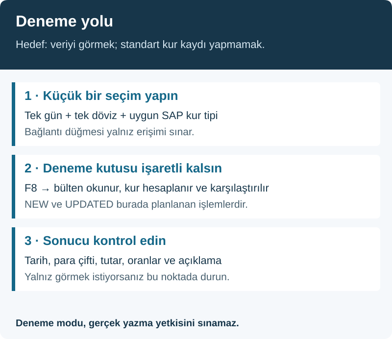

### A1. Tek gün ve tek döviz seçin

SE38'de `ZCHE_TCMB_LOAD` programını F8 ile açın. Örnek gün olarak bağlantıda okunmuş **30.10.2026** kullanılıyor; siz erişebildiğiniz başka bir bülten gününü seçebilirsiniz. `M`, sisteminizde tanımlı ve amacınıza uygun olması gereken örnek kur tipidir.

| Alan | İlk deneme seçimi |
|---|---|
| Dil / Language | Türkçe |
| Bülten tarih(ler)i | `30.10.2026`; sağdaki bitiş boş |
| Deneme (kur kaydedilmez) | **İşaretli** |
| Döviz alış | `M`; diğer beş kur alanı boş |
| Tarih kuralı | **Bülten ile aynı gün**; fabrika takvimi boş |
| TCMB döviz kodları | `USD` |
| Farklı SAP kodu / Ters yönü de yaz | Boş / işaretsiz |
| TCMB kurlarının para birimi | `TRY` |
| Mevcut farklı kur | **Olduğu gibi bırak**; açılıştaki Güncelle seçimini değiştirin |
| Bülten olmayan iş günü | Yalnızca listede göster |
| Kaynak | TCMB'den HTTPS ile; kurumunuz gerektirmiyorsa SM59, farklı adres ve klasör boş |

**Kur tutarı girmiyorsunuz:** Döviz alış yanındaki `M`, SAP kur tipidir. Tutar TCMB'den gelir. [Bütün alanların açıklaması](EKRAN_REHBERI.tr.md).

### A2. Bağlantıyı sınayın

**TCMB bağlantısını test et** düğmesine basın. Mesajı okuyup sağ alttaki yeşil onayla kapatın; bilgi penceresi açıkken arka plandaki alanlar soluk görünür.

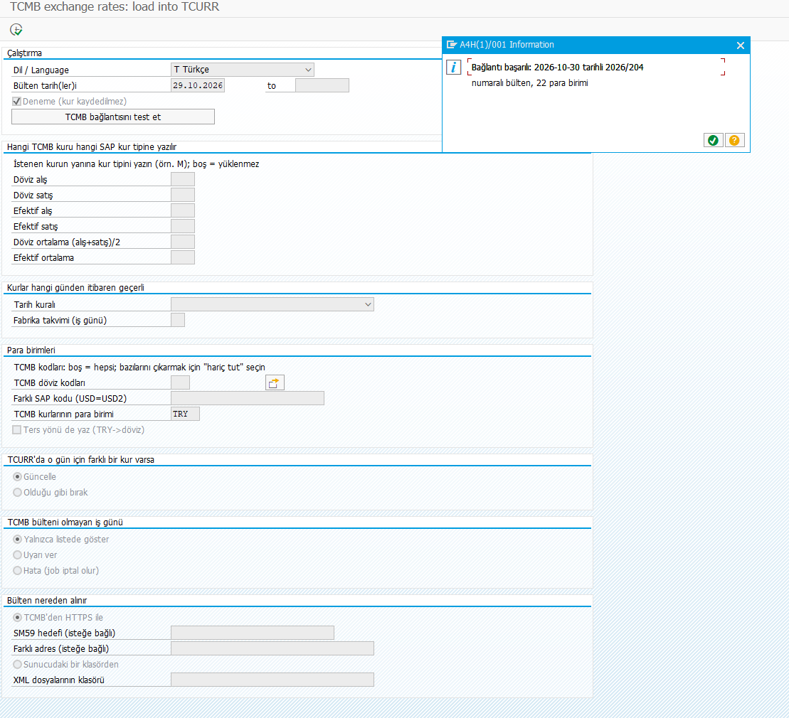

Bu örnekte 30.10.2026 bülteni okunmuş. Mesajdaki **22 para birimi**, kaydedilen kayıt sayısı değildir. Bağlantı düğmesi seçtiğiniz günü kullanmaz; son yedi gündeki erişilebilir bülteni arar. Kendi seçiminizin sonucunu sonraki adımda alırsınız.

### A3. F8 ile sonucu okuyun

**Deneme işaretli kalsın**, F8'e basın. Kur tipi, para çifti, geçerlilik tarihi, tutar ve oranları inceleyin.

| Sonuç | Denemede ne anlama gelir? |
|---|---|
| `NEW` — Yeni kayıt planlanıyor | Aynı anahtarda kayıt yok; gerçek çalıştırmada eklenebilir. |
| `UPDATED` — Güncelleme planlanıyor | Güncelle seçimiyle mevcut farklı değer değiştirilebilir. |
| `UNCHANGED` — Aynı kayıt mevcut | Mevcut değer eşit; yazmaya gerek yok. |
| `SKIPPED` — Atlandı | Açıklamayı okuyun; koruma seçimi veya eksik kur alanı olabilir. |
| `NO_BULLETIN` — Bülten yok | O gün için bülten alınamadı. Başka günün kuru otomatik kullanılmaz. |
| `ERROR` — Hata | Açıklamayı çözmeden gerçek kayda geçmeyin. |

**Bu ayrı örnek 27.10.2026'ya ait:** 1:1 oranla USD → TRY değeri `49,69970`, durum `UNCHANGED`. Seçim ekranı görünmediği için görüntü tek başına Deneme modunu kanıtlamaz. Yeni kayıt yapıldığını da göstermez. [Sütunları tek tek okuyun](EKRAN_REHBERI.tr.md#sonuç-listesinin-sütunları).

### A4. İsterseniz tarih aralığına geçin

Tek günlük sonucu doğruladıktan sonra bitiş tarihini doldurun; birden fazla dövizi çoklu seçimde ayrı satırlara girin. Cumartesi/pazar atlanır. İlk ve son gün aralığa dahildir.

**A4H üzerinde izlenen örnek:** 2 Kasım 2026'da aşağıdaki seçimle F8 çalıştırıldı. Bu örnek Temmuz ayındaki önceki kayıtları karşılaştırmak içindir; ilk denemenizde kendi tek gününüzü seçin.

1. **Deneme işaretli**, **Olduğu gibi bırak** seçili. Tarih aralığı 01.07.2026–01.08.2026, Döviz alış M, tarih kuralı SAME_DAY, hedef TRY ve kaynak HTTPS.

Deneme ve mevcut kayıtları koruma seçimi — ekranı aç

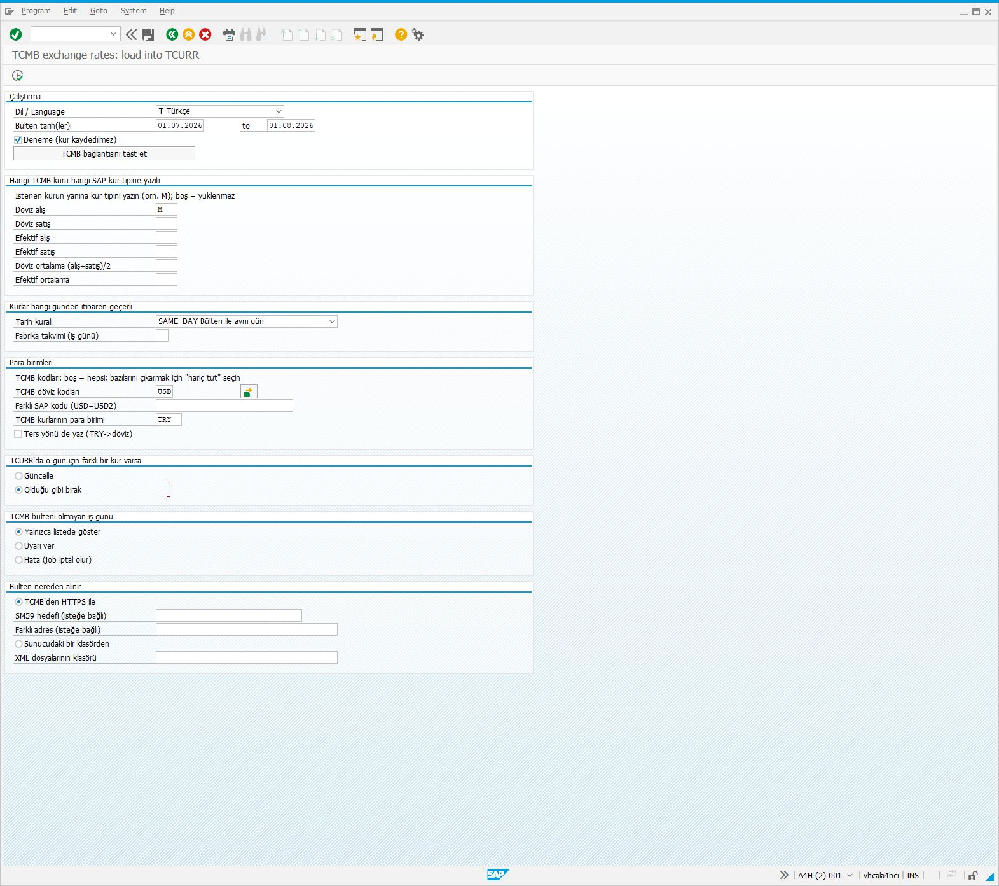

2. **TCMB döviz kodları** yanındaki çoklu seçim düğmesini açın. **Select Single Values** sekmesinde her dövizi ayrı satıra yazın; örnekte USD ve EUR var. Yeşil onay/aktarma düğmesiyle seçim ekranına dönün. Aralık veya hariç tutma sekmelerini yalnız bu davranışı istiyorsanız kullanın.

Çoklu seçimde USD ve EUR — ekranı aç

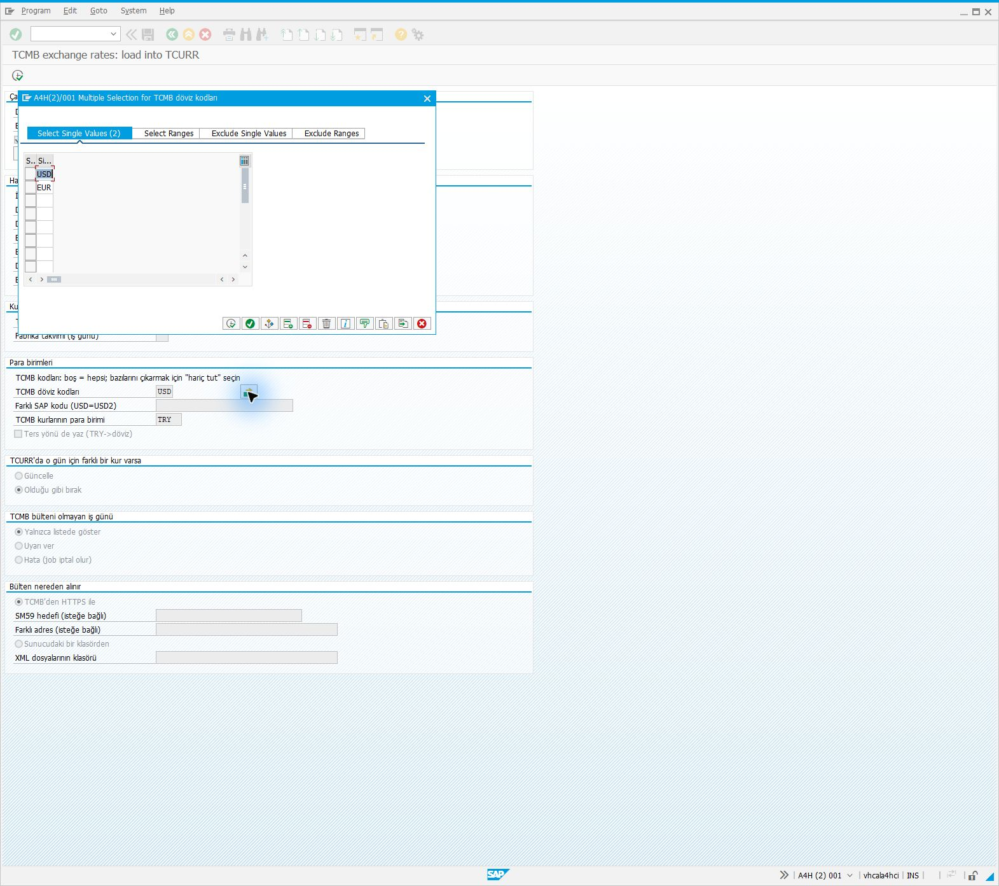

3. F8 sonrası **4 yeni kayıt planlanıyor, 40 kayıt aynı, 1 gün için bülten yok, 0 hata** görüldü. Alttaki özet **Deneme çalıştırması (kayıt yok)** diyor. Bu dört eksik kayıt yazılmadı.

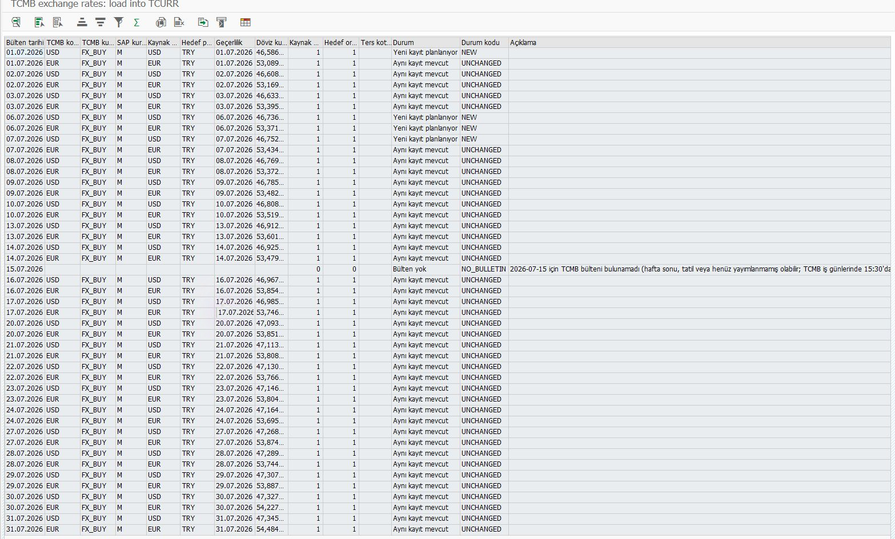

**Burada durabilirsiniz:** amacınız yalnızca görmekse Deneme işaretini kaldırmayın. Deneme modu yazma yetkisini veya kayıt kesinleştirmesini sınamaz. Özel exit eklediyseniz [testte yan etki kurallarını](TECHNICAL.tr.md#yerel-siniflar-ve-genisletme) uygulayın.

## Yol B — OB08'e kur eklemek veya güncellemek istiyorum

**Sonuç:** program standart kur kayıtlarını yazar; siz OB08'de doğrularsınız. OB08'e elle kur girmeniz veya ayrıca Kaydet'e basmanız gerekmez.

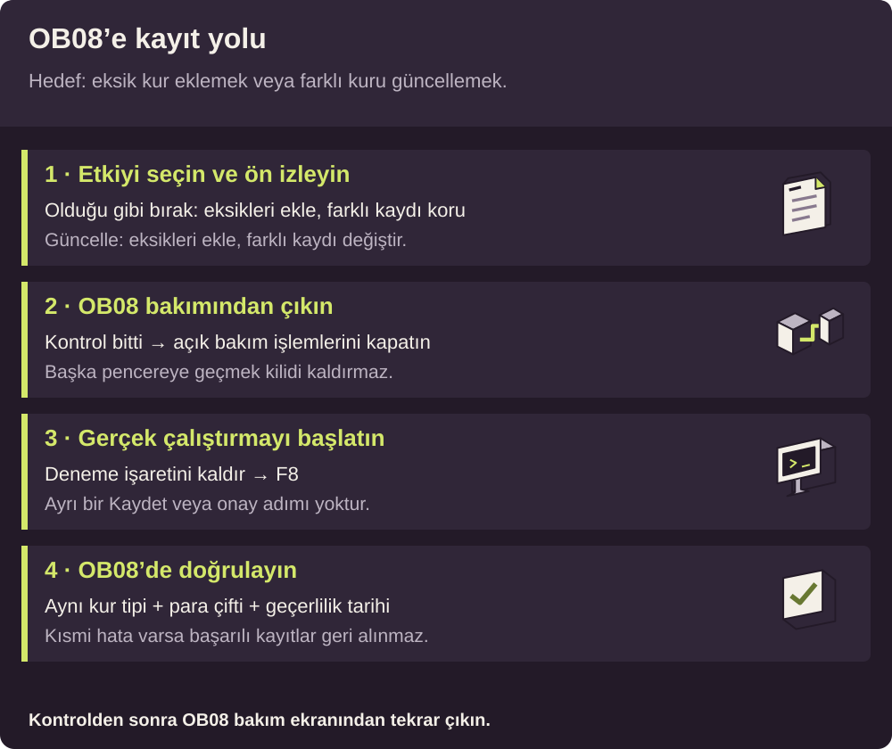

### B1. Ekleme mi, güncelleme mi?

| İstediğiniz davranış | Mevcut farklı kur seçimi | Sonuç |
|---|---|---|
| **Eksik kayıtları ekle; mevcut farklı değerlere dokunma** | **Olduğu gibi bırak** | Eksik kayıt eklenir; farklı mevcut kayıt atlanır. İlk deneme için bu yolu kullanın. |
| **Mevcut farklı kurları TCMB değeriyle değiştir; eksikleri de ekle** | **Güncelle** | Mevcut farklı kayıt değişir, eksik kayıt eklenir. Ön izlemedeki değişiklikleri kontrol edin. |

Her iki seçimde de eşit değer `UNCHANGED` olur. **Olduğu gibi bırak, bütün yazmayı kapatmaz.** Yazmayı kapatan seçenek Deneme kutusudur.

### B2. Önce kaydı ve deneme sonucunu kontrol edin

1. DEV/deneme ortamında [kurulumdaki 48 SAP Unit testini](#kurulum) çalıştırın; hata varsa çözün. Hatasız bir [Yol A ön izlemesi](#onizleme) alın.
2. Sonuçtaki **kur tipi + kaynak para birimi + hedef para birimi + geçerlilik tarihini** not edin. Örnek: `M / USD / TRY / 30.10.2026`.
3. `/oOB08` ile ayrı oturum açıp aynı kaydın mevcut durumunu kontrol edin. Yeni oturum açılamıyorsa seçimlerinizi not edip `/nOB08` kullanabilirsiniz. OB08'de veri değiştirmeyin.
4. **Kontrolden sonra OB08 bakım işleminden çıkın.** Başka SAP penceresinde açık bırakmak kilidi kaldırmaz. Kendi açık OB08 oturumlarınızdan çıkıp program ekranına dönün. Başkasının aktif kilidini silmeyin.
5. Yeni kayıt denemesinde ön izlemede `NEW` beklenir. Zaten `UNCHANGED` ise o satırın yeniden yazılmasına gerek yoktur. Sırf yeni kayıt sonucu almak için mevcut kuru silmeyin.

### B3. Gerçek çalıştırmayı başlatın

1. Programın seçim ekranında tarih, kur tipi, dövizler ve tarih kuralını son kez kontrol edin.
2. **Deneme (kur kaydedilmez) işaretini kaldırın.** B1'de seçtiğiniz koruma/güncelleme seçimi aynı kalsın.
3. Bu seçim ekranının görüntüsünü alın; kaldırılmış Deneme işareti ve seçimler görünür olsun.
4. **F8**'e basın. Ayrı bir onay veya Kaydet düğmesi beklemeyin; gerçek yazma başlar.
5. Sonuç listesini inceleyin. Gerçek çalıştırmada `NEW` yeni kayıt, `UPDATED` güncelleme bildirir. **ERROR varsa çalışma bütünüyle başarılı değildir; başarılı satırlar da otomatik geri alınmaz.** [Kısmi kayıt yolu](#kilit-ve-kismi-kayit).

### B4. OB08'de sonucu doğrulayın

Program bittikten sonra OB08'i tekrar açın. Aynı sistem/istemcide, sonuç satırındaki kur tipi, para çifti ve **geçerlilik tarihini** bulun. Gerekirse alttaki **Position / Konumlandır** düğmesini kullanın. Kur, doğrudan/ters kotasyon ve oranları karşılaştırın; tutarlar kesiliyorsa sütunları genişletin.

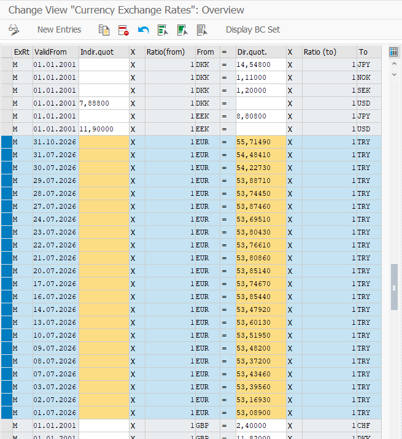

**Gerçek örnek:** OB08'de `M / EUR / TRY`, 1:1 oranla **01.07.2026 için 53,08900**, **31.07.2026 için 54,48410** görünüyor. Bu değerler o tarihlere aittir; başka güne kopyalamayın. Görüntü EUR kayıtlarını gösterir; bütün USD satırlarını veya hatalı satırların düzeltildiğini kanıtlamaz. SAP'nin kendi OB08 ekranı burada İngilizcedir; programın Türkçe seçimi SAP standart ekranını çevirmiyor.

**Kontrol tamamlanınca OB08 bakımından çıkın.** Programı tekrar çalıştıracaksanız bakım ekranını açık bırakmayın. SAP para çevrimiyle beklenen tutarı da doğrulayın; [hesap ve geri okuma ayrıntıları](TECHNICAL.tr.md#tarih-ve-oran-hesabı).

### B5. Aynı seçimi yeniden deneyin

Programda **Deneme kutusunu tekrar işaretleyin** ve aynı seçimle F8'e basın. Kaydedilmiş eşit satırlarda `UNCHANGED` beklenir. Kayıt öncesi seçim, gerçek sonuç, OB08 satırı ve tekrar deneme görüntülerini birlikte saklayın.

Gerçek kayıt standart **TCURR** tablosuna gider. Raporu başka Z adıyla kopyalamak kur verilerini ayırmaz. Tarih aralığı tek parça halinde kaydedilmez; bazı satırlar başarılı, bazıları hatalı olabilir.

## Yol C — Programı arka planda çalıştırmak istiyorum

**Büyük resim:** seçimlerinizi **varyanta** kaydedersiniz → **SM36** ile ne zaman çalışacağını tanımlarsınız → **SM37** ile sonucu izlersiniz. Varyant ayarları saklar; job bu ayarlarla programı çalıştırır. Spool, arka plandaki sonuç listesidir.

Önce bir kez, **kur yazmayan deneme job'ı** kurun. Aşağıdaki ekranlar A4H/001'de 2 Kasım 2026'da yapılan bu denemeden alındı. Program çıktısı Türkçe; SAP'nin standart job menüleri bu oturumda İngilizce.

### C1. Seçimlerinizi bir varyanta kaydedin

1. Yol A'daki seçim ekranında **Deneme işaretli**, dil **Türkçe** ve mevcut farklı kur için **Olduğu gibi bırak** olsun. Kendi test tarihinizi ve dövizlerinizi kontrol edin.
2. **Ctrl+S / Varyant olarak kaydet** ile yeni bir ad verin. Burada `TCMB_DOC_TEST` kullanıldı; kendi sisteminizde ayırt edici ve kullanılmayan bir ad seçin. Kısa açıklama yazıp kaydedin. Mevcut bir varyantın üzerine yazmayın.
3. Varyantı seçim ekranından tekrar çağırıp Deneme, tarih, dövizler ve dili kontrol edin. Bu örneğin tarihleri **sabittir**; günlük otomasyon için C7'yi izleyin.

Varyant adı ve öznitelikleri — ekranı aç

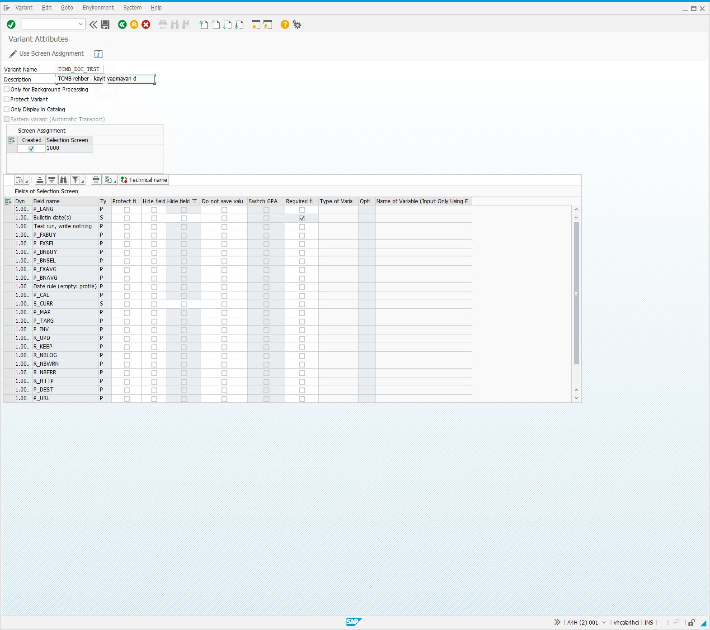

### C2. SM36'da işi adlandırın

Komut alanına **/nSM36** yazın. **Job Name** alanına kendi iş adınızı girin. Örnekte `ZTCMB_DOC_TEST_20261102` kullanıldı. **Job Class: C** bırakıldı; Target alanı bu sistemde boş. Kurumunuz özel sunucu veya sınıf gerektiriyorsa kendi kuralını uygulayın.

SM36 iş adı — ekranı aç

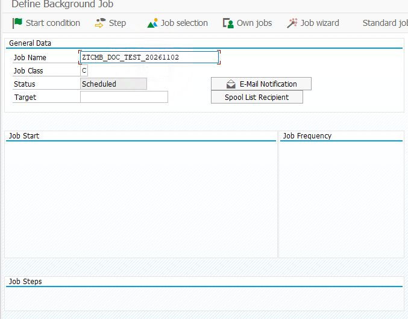

### C3. Çalışacak programı ve varyantı seçin

**Step / Adım** düğmesine basın. **ABAP program** bölümünde:

| Alan | Girilecek bilgi |
|---|---|
| Name | `ZCHE_TCMB_LOAD` |
| Variant | C1'de kaydettiğiniz deneme varyantı; örnekte `TCMB_DOC_TEST` |
| User | İşi çalıştırmaya yetkili kullanıcı; örnekte oturum kullanıcısı. `DEVELOPER` adını kendi sisteminize kopyalamayın. |
| Language | SAP çalışma dili. Örnekte EN; varyanttaki açık Türkçe seçimi programın kendi çıktısını yine Türkçe yaptı. |

Disk simgesiyle adımı kaydedin. Adım listesinde program ve varyantı kontrol edip F3 ile ana iş ekranına dönün. **1 Step(s) defined** görünmeli.

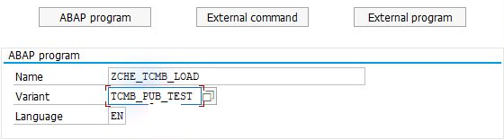

### C4. Bir kez hemen çalıştırın

**Start condition → Immediate** seçin. **Periodic Job işaretsiz** kalsın. Pencerenin disk simgesiyle başlangıç koşulunu kaydedin; ardından ana SM36 ekranında **Ctrl+S** ile işi kaydedin. Bu son kayıt işi başlatılabilir duruma getirir.

Immediate seçili, Periodic Job işaretsiz — ekranı aç

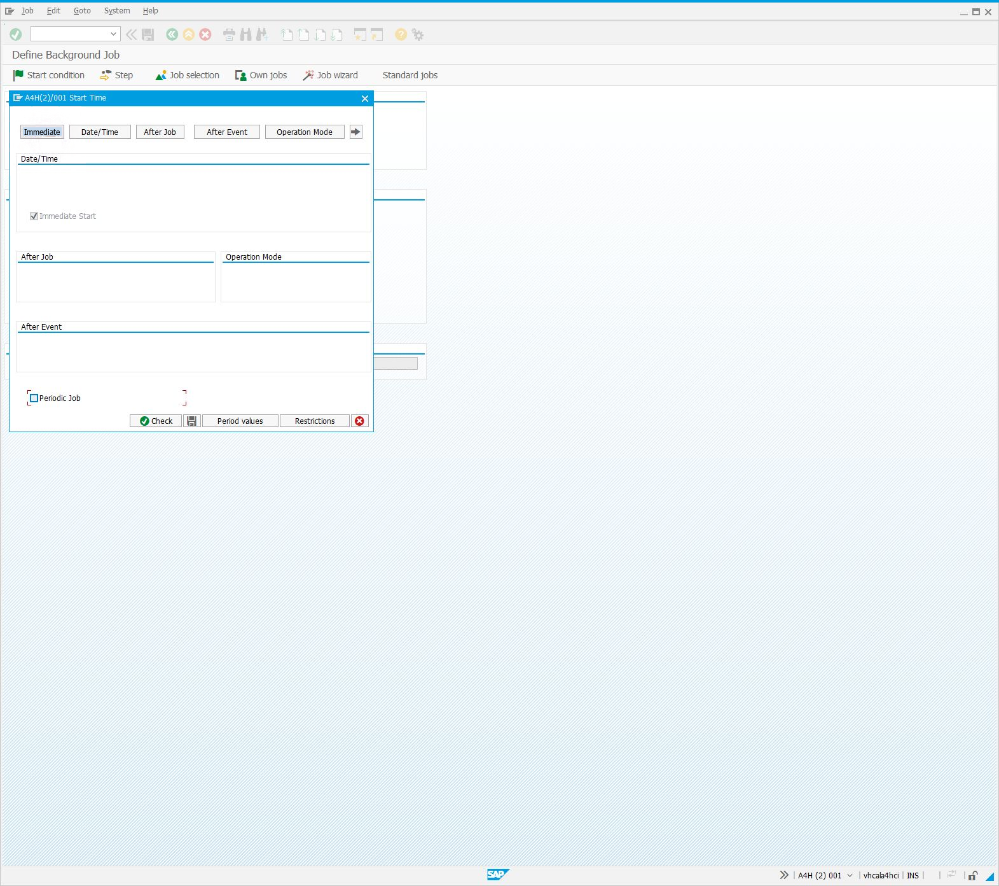

Alt mesajda **saved with status: Released** görünmesini kontrol edin. Yalnız **Scheduled** görünmesi henüz çalışacağı anlamına gelmez; başlangıç koşulunu ve serbest bırakma yetkisini inceleyin.

Job kaydedildi ve Released mesajı alındı — ekranı aç

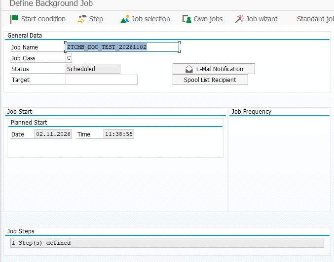

### C5. SM37'de tamamlanmasını izleyin

1. **/nSM37** açın. **Job Name** alanına kendi iş adınızı, **User Name** alanına ilgili kullanıcıyı girin.
2. Tarih aralığı job'ın çalıştırıldığı günü kapsasın. Released, Ready, Active, Finished ve Canceled durumlarını seçip F8'e basın. Listede yoksa Scheduled seçimini de dahil edip başlangıç koşulunu kontrol edin.
3. **Refresh** ile yenileyin. Örnekte iş 74 saniyede **Finished** oldu; sizin sisteminizde süre değişebilir.

SM37 iş adı, kullanıcı ve tarih filtresi — ekranı aç

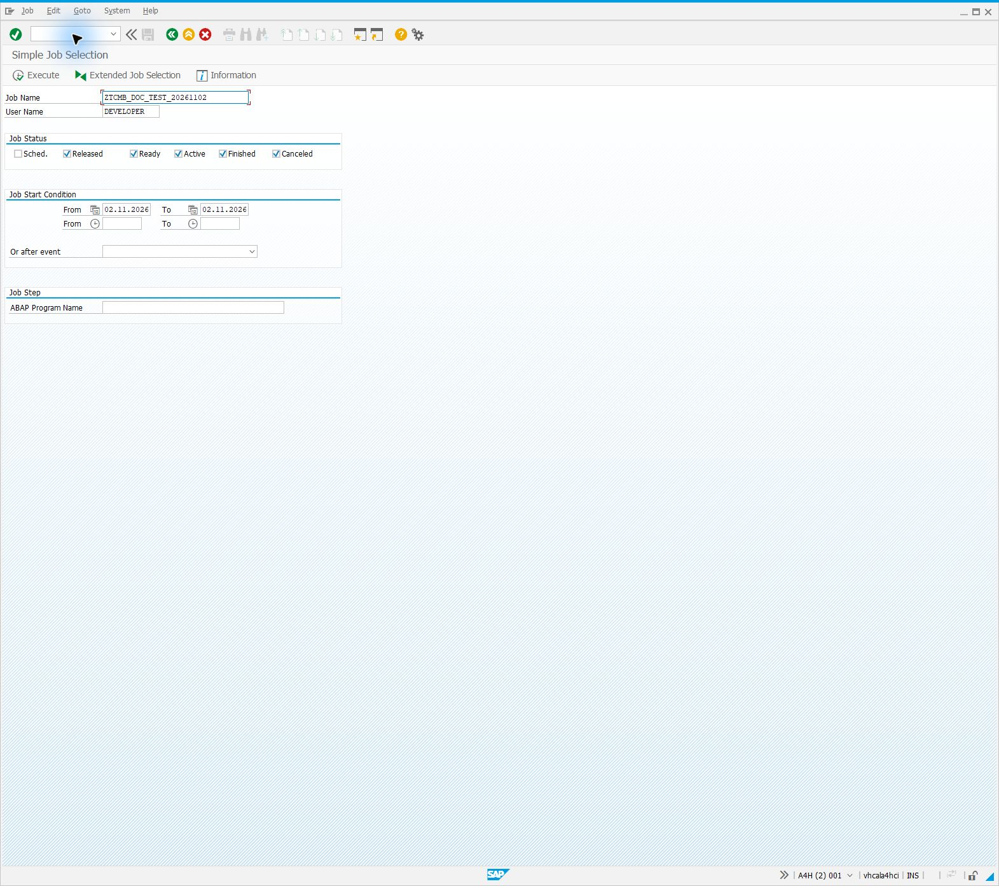

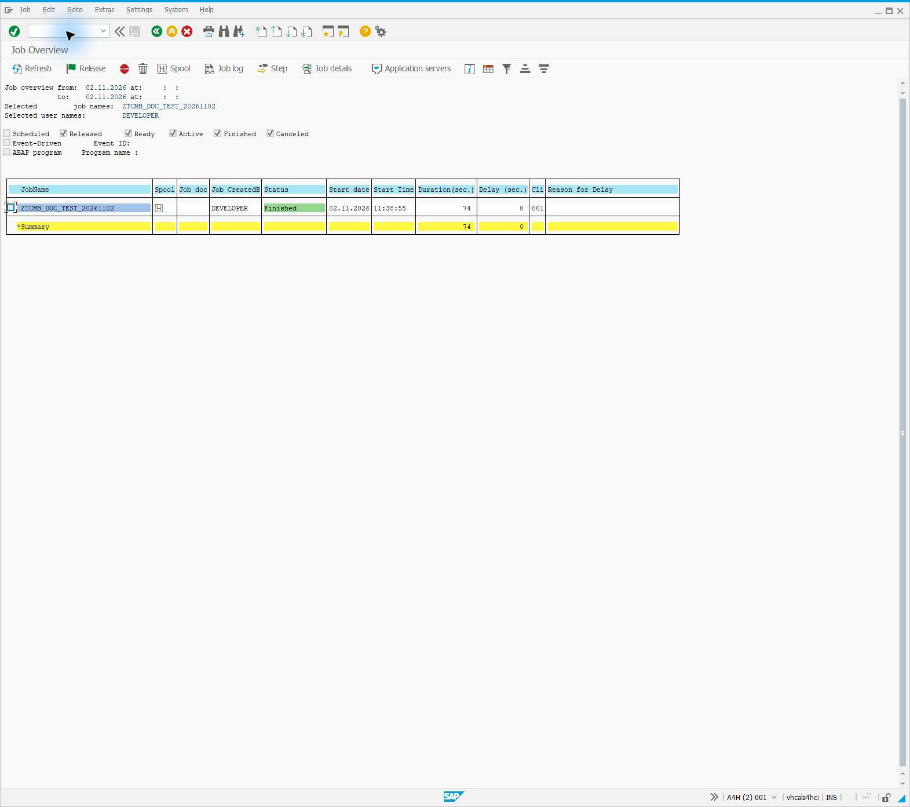

### C6. Job logunu ve spool'u okuyun

İş satırının solundaki kutuyu seçin ve **Job log** düğmesine basın. Örnekte programın Türkçe özeti **Deneme çalıştırması (kayıt yok): 4 yeni, 0 güncellenen, 40 değişmeyen, 0 atlanan, 1 bülten bulunamayan gün, 0 hata** diyor.

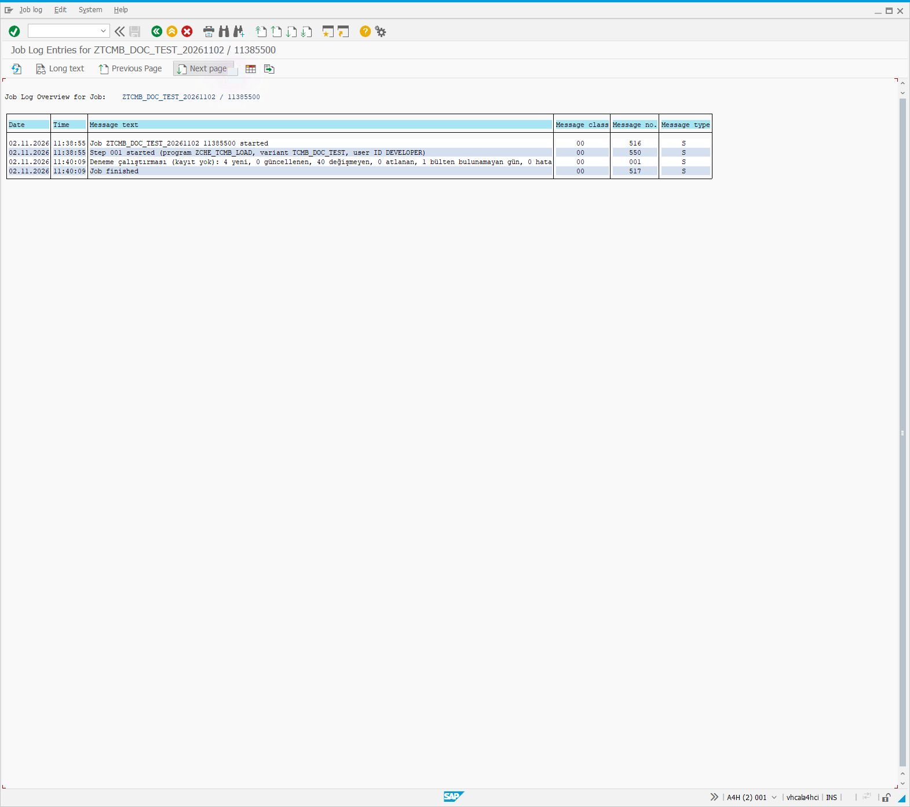

F3 ile listeye dönün. Seçili iş için **Spool** düğmesine basın; spool listesindeki **Type / belge simgesini** açın. **Yazdır düğmesine basmanız gerekmez.** Sonuç satırlarının tarihini, para çiftini, kur tipini ve durumunu inceleyin. Ekran küçük görünüyorsa görsele tıklayıp tam boy açın.

İşin spool isteği — ekranı aç

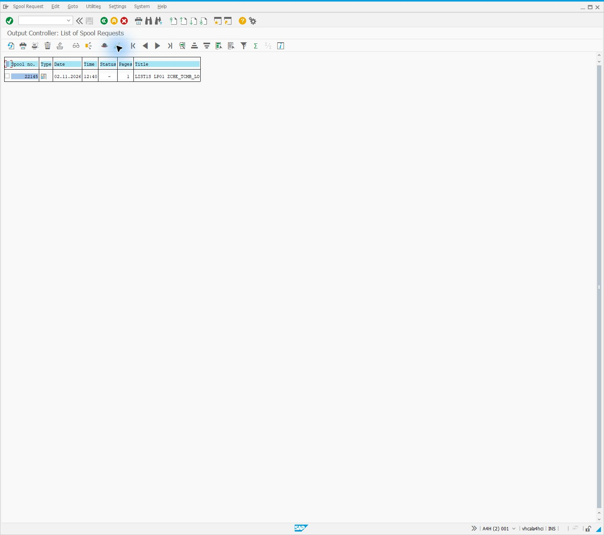

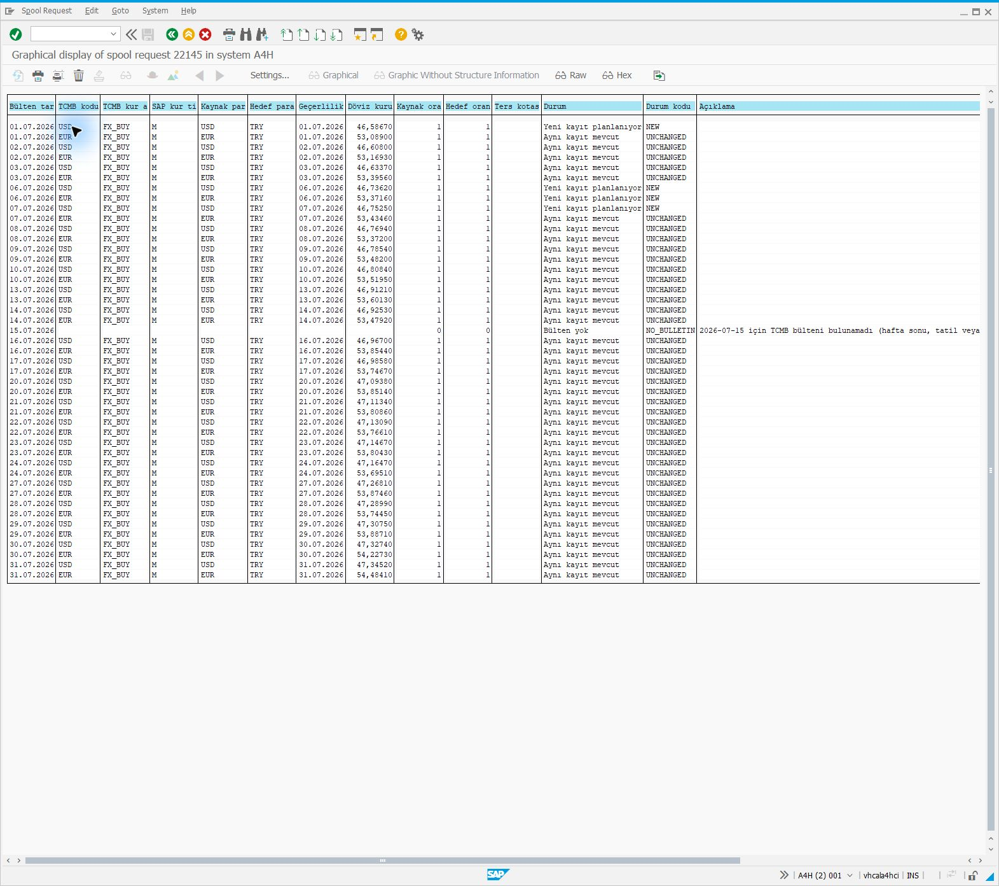

**Kontrol noktası:** bu deneme işi tamamlandı; kur kaydı yapmadı. `Finished` tek başına kur yazıldığının kanıtı değildir. Buradaki `NEW`, **Yeni kayıt planlanıyor** anlamında. Önceki kilit hatalarıyla ilişkili 1 Temmuz USD, 6 Temmuz USD/EUR ve 7 Temmuz USD kayıtları hâlâ eksik. Tamamlamak için [Yol B'yi](#ilk-kayit) izleyin.

### C7. Günlük otomasyona geçerken ne değişir?

Önce Yol B ile gerçek kayıt ve OB08 kontrolünü tamamlayın. Yukarıdaki sabit Temmuz varyantını her gün tekrar çalıştırmayın.

1. Ayrı bir günlük varyant oluşturun; örneğin `TCMB_GUNLUK`. **S_DATE** için varyant özniteliklerinden **D / Dinamik tarih → Güncel tarih** seçin. Sabit başlangıç/bitiş aralığını taşımayın; varyantı tekrar çağırıp tek günün hesaplandığını kontrol edin.
2. Önce günlük varyantı **Deneme işaretli** sınayın. Gerçek kayıt için deneme işaretini kaldırıp kaydedin; **Olduğu gibi bırak / Güncelle** kararını Yol B'ye göre verin.
3. SM36'da ayrı iş adı ve günlük varyantla adım oluşturun. **Start condition → Date/Time** ile ilk çalışma tarih/saatini, **Periodic Job → Period values → Daily** ile günlük tekrarı tanımlayın. Başlangıç koşulunu ve ana işi kaydedin.
4. Saati bültenin yayımlanmasından sonraya planlayın; SAP sistem/job saat dilimini doğrulayın. Ekrandaki örnek saatleri kopyalamayın.
5. İlk işleri SM37 log/spool ve OB08 ile doğrulayın. Canceled veya satır hatası varsa önceki başarılı kayıtlar otomatik geri alınmaz. Hedef sistemlerde bağlantı, FI ayarları, varyant ve çalışma kullanıcısını ayrıca kontrol edin.

Bu oturumda **sabit tarihli, tek seferlik ve kur yazmayan iş** doğrulandı. Günlük dinamik tarih, periyodik gerçek yazma ve sınırlı yetkili kullanıcı kabulü henüz yapılmadı; bunlar yukarıdaki deneme ekranlarının kanıtladığı kapsamın dışındadır.

## Sorun çözme — Bazı satırlar yazıldı, bazıları hata verdi

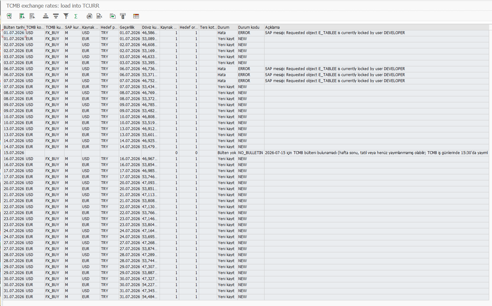

Bu örnekte üç ayrı sonuç var:

| Görülen sonuç | Anlamı | Yapılacak işlem |
|---|---|---|
| `NEW / Yeni kayıt` | Program bu satırları yazdığını bildiriyor. | Aynı anahtar/tarihi OB08'de doğrulayın. |
| `ERROR` ve `E_TABLE ... locked by user DEVELOPER` | SAP kayıt isteğini kilit nedeniyle reddetmiş. | Hatalı tarih ve para birimlerini not edin; aşağıdaki sırayla ilerleyin. |
| `15.07.2026 / NO_BULLETIN` | O tarih için bülten bulunamamış. | Kilit hatasından ayrı değerlendirin; başka günün kurunu bu tarihe kopyalamayın. |

Bu sonuç listesindeki **Yeni kayıt** açıklamaları ve BAPI kilit mesajları gerçek yazma yoluyla uyumlu. Ancak yukarıdaki seçim görüntüsünde **Deneme işaretli**; bu iki ekranı aynı çalıştırmanın kanıtı olarak birleştirmiyoruz.

1. **Güncelle seçimiyle bütün ayı hemen tekrar çalıştırmayın.** Önce sonuç listesini ve hata mesajlarını saklayın.
2. OB08'de başarılı ve hatalı satırların mevcut durumunu kontrol edin; sonra **OB08 bakım işleminden çıkın**. Görüntüdeki açık **Change View** ekranı kilidin olası kaynağıdır; tek başına kesin nedeni kanıtlamaz.
3. Kendi diğer SAP oturumlarınızda açık bakım işlemlerinden de çıkın. Kilit sürüyorsa kilit sahibi/ilgili yöneticiyle **SM12 üzerinden kilit sahibini ve nesnesini inceleyin**. Aktif kilidi genel çözüm olarak silmeyin. [SAP'nin kilit yönetimi açıklaması](https://learning.sap.com/courses/technical-implementation-and-operation-i-of-sap-s-4hana-and-sap-business-suite/describing-as-abap).
4. Kilit nedeni giderilince **yalnız etkilenen gün/para birimlerini**, **Deneme işaretli** ve **Olduğu gibi bırak** seçimiyle tekrar değerlendirin. Böylece başarılı farklı kayıtlar korunur; eşit kayıtlar UNCHANGED, eksikler NEW olur.
5. Eksik kayıtları Yol B ile tamamlayın; OB08'de tekrar doğrulayın. Güncellemek istediğiniz mevcut farklı satırları ayrı ve açık bir seçimle ele alın.

Commit/kayıt kesinleştirme hatası varsa yeniden denemeden önce OB08 ve SM13'le mutabakat yapın. [Teknik hata ve yeniden deneme açıklaması](TECHNICAL.tr.md#hatalar-ve-yeniden-deneme).

## Dosyadan okuma

Yalnız SAP'nin TCMB'ye HTTPS erişimi yoksa kullanın. Program **SAP uygulama sunucusunun okuyabildiği klasörü** okur; kendi bilgisayarınızın İndirilenler klasörünü kullanmaz. Otomatik indirici projeye dahil değildir.

Sunucu dosyalarını hazırlama adımları

1. Yetkiniz varsa kurumunuzun izin verdiği RDP (Windows), SSH (Linux) veya yönetilen dosya aktarımıyla sunucuya erişin; yoksa sunucu sorumlusuyla hazırlayın.
2. Tam günlük XML'i `GGAAYYYY.xml` adıyla koyun. **30.10.2026 bir örnektir:** o günün dosyası `30102026.xml` olur. Kendi seçtiğiniz günün dosya adını kullanın; XML içindeki bülten tarihi de eşleşmeli. Okunan klasöre yalnız tamamlanmış dosyaları alın.
3. **Sunucudaki bir klasörden (`R_FILE`)** seçin; **XML dosyalarının klasörü (`P_DIR`)** alanına gerçek sunucu klasörünüzü girin. Sabit örnek klasör kopyalamayın.
4. İşletim sistemi ve SAP dosya okuma yetkilerini kontrol edin. Birden fazla uygulama sunucusunda job'ın aynı dosyalara ulaşabildiğini doğrulayın.
5. Dosyanın tarihiyle test çalıştırın. Bağlantı düğmesi son yedi güne bakar; yalnız eski bir dosyanız varsa o tarihte doğrudan test yapın.

**Eksik veya okunamayan dosya `ERROR` olur.** Bu, tatil kanıtı değildir. Kaynak değiştirme veya otomatik indirme yapılmaz.

## Diğer sorunlarda ilk kontrol

| Belirti | Nereye bakmalı? |
|---|---|
| Kaynak yüklenemiyor / ekran açılmıyor | [Kurulum](#kurulum): tam kaynak, satır uzunluğu, etkinleştirme ve tam hata mesajı. |
| Kur tipi veya tarih kuralı isteniyor | [Ekran rehberi](EKRAN_REHBERI.tr.md): en az bir kur tipi ve listeden tarih kuralı. |
| SSL / bağlantı hatası | SAP sunucusundan HTTPS erişimi, STRUST güveni ve varsa SM59. [Bağlantı ayrıntıları](TECHNICAL.tr.md#kaynaklar). |
| TCURF / oran hatası | OBBS'de doğru anahtar, geçerlilik tarihi ve pozitif oranlar. |
| Dosya okunamıyor | Gerçek sunucu klasörü, tarihli dosya adı ve okuma izinleri. |

İsteğe bağlı: abapGit ile kurulum

Depoyu müşteri paketinize alıp Pull/aktivasyon yapabilirsiniz. Çevrimdışı ZIP aktarımı da kullanılabilir. abapGit program özelliklerini ve metin öğelerini getirir; günlük çalışma ona bağlı değildir. Aynı programı iki yöntemle üst üste yüklemeyin.

