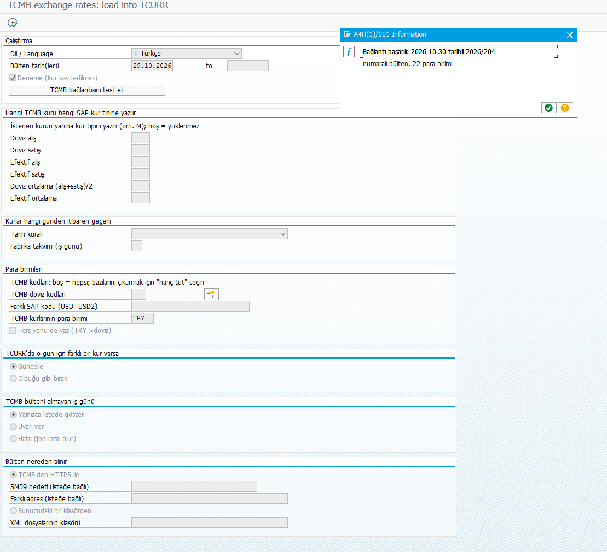
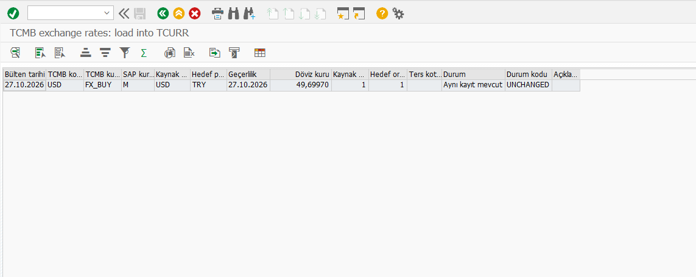

# Validation record — v0.3.0 integration candidate

Date: 2 November 2026. This record separates maintainer-supplied handoff reports from checks performed during integration. No SAP GUI actions or exchange-rate writes were performed during this integration; the operator elected to perform SAP steps personally.

## Source provenance

- Baseline: [single-program commit 9b1fc51](https://github.com/Cheditte/abap-tcmb-rates/commit/9b1fc51).
- The source in the supplied tcmb-handoff.zip matches that Git source after line-ending normalization.
- Baseline source SHA-256 (LF): bb9ee67592ddc80a864256a8a4f920d45819f3c918eb74528cabbc28d5118866.
- Integrated source SHA-256 (LF): 32de9aef8a306973110f3856cedb13072f65b5928d5b99a3fb33af31fcc3542b.
- The integration branch starts from main; unrelated single-program history was copied deliberately rather than force-pushed over main.

## Results reported in the handoff

These are reports from the prior work, not fresh execution observed during integration. The supplied ZIP contains source/docs/checker stubs, not original SAP logs or current GUI evidence.

| Reported check | Reported outcome |
|---|---|
| System | SAP ABAP Platform 2023 trial, described as SAP_BASIS 7.58. Exact SP/kernel evidence was not supplied. One bundled README inconsistently says 816; that number is not used as a verified SAP_BASIS release. |
| Activation | No activation messages. |
| SAP Unit | 34 tests passed for the handoff edition. |
| Preview job | USD/JPY, 27–30 October, forex buying to example M, next working day with the reported TR calendar; JPY per 100 units and 100:1 ratio. No HTTP bulletins reported for 28–29 October. |
| Invalid date rule | Job cancelled with a configuration message. |
| File warning | Missing file was classified NO_BULLETIN in the handoff. This is changed below and requires retest. |
| Limited actual write | USD/TRY for 27 October: NEW, then UNCHANGED on rerun. This is not evidence of OB08/readback for the integrated source. |

Earlier multi-object readback and installer results remain historical. See the [previous record](validation-2026-11-02.md).

## Integration corrections

- Reject non-TRY targets, invalid/duplicate currency codes, impossible dates, invalid/nonpositive supplied values and missing/fractional/nonpositive Units.
- Validate positive factors/Units before calculation and catch arithmetic/assignment overflow.
- Treat all failed file opens as FILE/ERROR rather than assuming a holiday; preserve repeated spaces in server paths.
- Keep earlier date results visible when a later source/parse failure stops the range.
- Respect Keep policy at the BAPI update flag, check BAPI/commit returns and report failed commits as ERROR. Commits are per row, so a range remains non-atomic.
- Use the actual current certificate chain rather than prescribing one root name.
- Add ten integration regression tests and four language tests: the integrated report contains 48 SAP tests. These additions were not executed in SAP here.

## Local integration checks

| Check | Outcome and limit |
|---|---|
| abaplint 2.120.92, v700 | 0 issues. Three small standard-object stand-ins; incomplete SAP API/type definitions. Not a runtime compatibility result. |
| Supplemental source check | Single report/metadata and selected classic-syntax restrictions checked. Discovers 48 tests; does not execute them. Checks 56 bilingual message templates for key references/placeholder parity and all 14 ALV headers. |
| Whole-report JavaScript transpilation attempt | Failed dependency resolution for selection-screen types, SALV and CL_AUNIT_ASSERT, among others. The old test:logic runner/dependencies were removed; no old test count is claimed for the new report. |
| Documentation | Bilingual links/anchors and diagram layouts checked separately. Diagram art illustrates the intended workflow and is not a simulated SAP success capture. |

## Turkish/English presentation update

The report now has P_LANG values A (automatic/logon), T (Türkçe), E (English). The selection is applied at initialization, selection-screen PBO/PAI and START-OF-SELECTION for background runs. Variants can store an explicit choice independently of the execution logon language. Project-authored messages and ALV headings/descriptions use that choice; technical status codes, rate keys and calculations remain unchanged. Raw SAP/BAPI/OS messages and GUI menus retain their underlying language.

The four added native tests cover explicit/automatic choice, dynamic parameters containing placeholder-like text, technical status stability and visible unknown keys. Tests save/restore the language state; existing English wildcard assertions explicitly select English. The operator subsequently supplied the Turkish selection-screen and connection-success capture documented below. It does not show the language-switching interaction itself. Verify immediate refresh after USER-COMMAND LANG, saved language variants and job log/spool separately.

## Operator-supplied screen evidence — 2 November 2026

The operator supplied this screenshot after receiving the language-enabled report. The original PNG was copied unchanged; no SAP GUI actions were performed by the documentation editor.

- Visible: P_LANG is T / Türkçe, Turkish selection labels and the Turkish test-mode label; a Turkish success message reports bulletin 2026/204 dated 2026-10-30 with 22 currencies.
- Interpretation: the displayed connection test succeeded in reading a bulletin. Its last-seven-days search is separate from the selected S_DATE (2026-10-29 in the image). The currency count is a parsed bulletin count, not a write count.
- Limits: rate mappings and date rule are still empty; no F8 rate preview, ALV translation, 48-test result, BAPI write or OB08 readback is evidenced. The screenshot does not attest the complete installed source hash, older-release compatibility, clean installation or the language-switching interaction.
### Turkish result list supplied subsequently

- Visible: one row for bulletin date and valid-from date 2026-10-27, USD, FX_BUY, rate type M, USD to TRY, rate 49.69970, factors 1:1, blank indirect-quotation flag, Turkish status description "Aynı kayıt mevcut" and technical status UNCHANGED. Several column headings are shortened by their display width.
- Interpretation: the result reports that the calculated rate already matches the SAP record. Turkish result headings and the localized unchanged-status description are now evidenced in a real result list.
- Limits: the selection screen/test flag and data-source selection are not visible. This is not evidence of a current BAPI write or an independent OB08 readback. It uses 27 October, whereas the walkthrough's initial-entry example uses 30 October; they must not be presented as the same run. Complete source identity and the 48 native tests remain unverified by this screenshot.
- Next screen evidence: completed Turkish selections with test mode visible; multiple-currency selection if used; preview of a proposed new record; SAP Unit results; controlled write and matching OB08 record; saved variant and scheduled job results. These are not represented by mock screenshots.

## Outstanding SAP acceptance

Run the [acceptance checklist](../CONTRIBUTING.md#sap-acceptance-checklist) against the integrated source hash: clean paste/upload and fixed-point arithmetic; actual GUI labels/listbox/connection button; all 48 tests; HTTPS/dry run; controlled write plus OB08/conversion readback; file errors/path spaces; failure recovery/commit and concurrency; saved variants/dynamic-date SM36 jobs; restricted user; SM59; optional abapGit; custom exits; actual older releases.

Old settings/installer screenshots are historical evidence for the earlier architecture and are not used as current single-report screens. The new Turkish connection and result images above were supplied by the operator and illustrate only their visible states; the outstanding acceptance checks remain pending.
